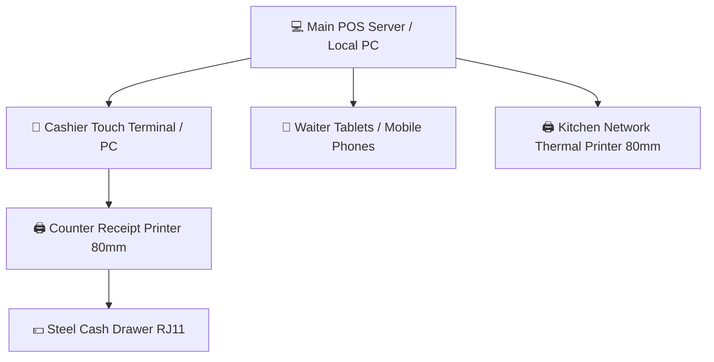

# စားသောက်ဆိုင် POS စနစ် အမျိုးအစား ခွဲခြားခြင်းနှင့် လုပ်ငန်းခွင် လိုအပ်ချက်များ (Restaurant POS Classification & Operational Requirements)

> [!IMPORTANT]
> ### ⚠️ Git Branch & Commit Reminder Alert (Git Branch နှင့် Commit သတိပေးချက်)
> **လက်ရှိ Active ဖြစ်နေသော Git Branch**: `develop`
> 
> စနစ်ပြင်ဆင်မှုများ မစတင်မီ မိမိရောက်ရှိနေသော Git Branch အား သေချာစွာ စစ်ဆေးပေးပါရန် သတိပေးအပ်ပါသည်။
> 
> **Suggested Conventional Commit Message:**
> ```text
> docs(pos): define restaurant pos system classification and operational requirements
> ```
> 
> **Ready-to-run Git Command:**
> ```bash
> cd backendPos
> git add .
> git commit -m "docs(pos): define restaurant pos system classification and operational requirements"
> ```

---

# 💡 သင့်စနစ်သည် မည်သည့် POS စနစ် အမျိုးအစား ဖြစ်သနည်း? (What POS System is this?)

သင်တည်ဆောက်ထားသော စနစ်သည် ကုန်စုံဆိုင် (Retail) သို့မဟုတ် ကောင်တာတစ်ခုတည်းသုံး ရိုးရိုး POS မဟုတ်ပါ။ နိုင်ငံတကာ စားသောက်ဆိုင်လောကတွင် **"Hybrid Table-Service & Smart QR Dining Restaurant POS"** ဟု ခေါ်ဆိုသော **စားသောက်ဆိုင်ကြီးများသုံး အဆင့်မြင့် POS စနစ်** ဖြစ်ပါသည်။

---

## ၁။ ဤ POS စနစ်သည် မည်သည့် စားသောက်ဆိုင် ပုံစံများအတွက် ရည်ရွယ်သနည်း? (Target Restaurant Models)

ဤစနစ်သည် အောက်ပါ စားသောက်ဆိုင် အမျိုးအစားများအတွက် ၁၀၀% အံဝင်ခွင်ကျ အသုံးပြုနိုင်ပါသည်:

1. **Full-Service / Casual Dining Restaurants (ထိုင်စား စားသောက်ဆိုင်ကြီးများ)**:
   - ဥပမာ- Hotpot ဆိုင်များ၊ BBQ ဆိုင်များ၊ Japanese / Thai / Western Bistro စားသောက်ဆိုင်များ၊ Seafood စားသောက်ဆိုင်များ။
   - **အဘယ်ကြောင့်ဆိုသော်**: စားပွဲခုံများ (Tables)၊ ဧည့်သည်ဦးရေ (Pax)၊ စားပွဲထိုင် ဝန်ထမ်း (Waiters)၊ မီးဖိုချောင် (Kitchen Pass) နှင့် ငွေရှင်းကောင်တာ (Cashier Register) ဟူ၍ အဆင့်ဆင့် လည်ပတ်သောကြောင့် ဖြစ်ပါသည်။

2. **Saizeriya (ဂျပန်) / MK Suki / HaiDiLao စတိုင်လ် Smart Dining ဆိုင်များ**:
   - ဧည့်သည်က စားပွဲခုံပေါ်ရှိ QR Code ကို မိမိဖုန်းဖြင့် Scan ဖတ်ပြီး အော်ဒါတင်နိုင်သလို၊ လိုအပ်ပါက ဝန်ထမ်း (Waiter) ကလည်း Tablet ဖြင့် အော်ဒါကူရိုက်ပေးနိုင်သော **Hybrid Model** ဖြစ်ပါသည်။

---

## ၂။ ဤ POS စနစ် လက်တွေ့ဆိုင်တွင် လည်ပတ်ရန် ဘာတွေ လိုအပ်သနည်း? (Hardware & Setup Requirements)

သင့်စနစ်ကို လက်တွေ့ စားသောက်ဆိုင်တွင် တပ်ဆင်အသုံးပြုမည်ဆိုပါက အောက်ပါ ပစ္စည်းများသာ လိုအပ်ပါသည်:



| စက်ပစ္စည်း (Device) | အသုံးပြုမည့်နေရာ | အသေးစိတ် လိုအပ်ချက် |
| :--- | :--- | :--- |
| **၁။ Cashier Counter Terminal** | ငွေရှင်းကောင်တာ | Touchscreen PC (All-in-One POS) သို့မဟုတ် လက်ပ်တော့/iPad။ |
| **၂။ 80mm Thermal Receipt Printer** | ငွေရှင်းကောင်တာ | USB/LAN ချိတ်ဆက်ထားသော 80mm Thermal Printer (Epson, Sunmi, Xprinter)။ |
| **၃။ Automatic Cash Drawer** | ငွေရှင်းကောင်တာ | Printer ၏ RJ11 Port တွင် ချိတ်ဆက်ပြီး စလစ်ထွက်လျှင် အလိုအလျောက် ပွင့်မည့် သံမဏိ ငွေအံဆွဲ။ |
| **၄။ Waiter Tablets / Phones** | စားပွဲထိုး ဝန်ထမ်းများ | Android Tablet သို့မဟုတ် Mobile Phone (Google Chrome ဖြင့် စားပွဲအော်ဒါယူရန်)။ |
| **၅။ Kitchen Thermal Printer** | မီးဖိုချောင် (Kitchen) | LAN ကြိုး (Network Cable) ဖြင့် ချိတ်ဆက်ထားသော 80mm အပူခံပရင်တာ (Kitchen Chit စလစ်ထုတ်ရန်)။ |
| **၆။ Wi-Fi Router** | ဆိုင်တစ်ခုလုံး | ဆိုင်တွင်း Local Network (အင်တာနက် လိုင်းကျနေသော်လည်း ဆိုင်တွင်း စလစ်ထုတ်ခြင်းနှင့် အော်ဒါယူခြင်းများ မပြတ်တောက်စေရန်)။ |

---

## ၃။ Quick Service (Fast Food) POS နှင့် ဘာကွာခြားသနည်း? (FSR vs QSR Comparison)

| အချက် | သင့်စနစ် (Table-Service POS) | Fast Food POS (QSR - ဥပမာ: Lotteria, KFC) |
| :--- | :--- | :--- |
| **အော်ဒါယူပုံ** | စားပွဲထိုင်ပြီးမှ မှာယူသည် (သို့မဟုတ် စားပွဲ QR ဖတ်သည်) | ကောင်တာတွင် တန်းစီပြီး မှာယူသည် |
| **ငွေရှင်းပုံ** | **စားသောက်ပြီးမှ ငွေရှင်းသည်** (Post-Pay) | **အရင်ငွေရှင်းပြီးမှ စားသည်** (Pre-Pay) |
| **အော်ဒါထပ်မှာခြင်း** | အကြိမ်ကြိမ် အပိုထပ်မှာနိုင်သည် (Repeat Rounds) | အော်ဒါတစ်ခါမှာ တစ်ခါရှင်း |
| **မီးဖိုချောင်** | ဟင်းချက်စလစ် (Kitchen Chit) သီးသန့်ထွက်သည် | Token နံပါတ်ဖြင့် ပစ္စည်းထုတ်ပေးသည် |

---

## ၄။ ဤ POS စနစ် ၁၀၀% ပြည့်စုံရန် နောက်ထပ် ဘာစနစ်တွေ ထပ်လိုသေးသနည်း? (What features are needed next?)

သင့်စနစ်ကို လုပ်ငန်းခွင်တွင် အမှားအယွင်းကင်းကင်းနှင့် စုံလင်သွားစေရန် အောက်ပါ အချက် (၃) ချက်ကို ဆက်လက်ထည့်သွင်းရန် အကြံပြုပါသည်:

1. **Takeaway / Counter Quick Order (ပါဆယ်စနစ်)**:
   - စားပွဲမထိုင်ဘဲ ကောင်တာတွင် တိုက်ရိုက်ပါဆယ်မှာယူသူများအတွက် Token နံပါတ်ဖြင့် အော်ဒါယူပြီး ငွေကြိုရှင်းနိုင်သည့် စနစ်။
2. **Manager PIN Authorization for Dish Void (ဟင်းပွဲဖျက်သိမ်းမှု ခွင့်ပြုချက်)**:
   - ဝန်ထမ်းများ မှားရိုက်မိသော ဟင်းပွဲ သို့မဟုတ် ဧည့်သည်ဖျက်လိုသော ဟင်းပွဲများကို မန်နေဂျာ PIN ရိုက်ပြီးမှ ဖျက်ခွင့်ပေးသည့် စနစ်။
3. **Table Dirty / Cleaning Status (စားပွဲ သန့်ရှင်းရေး အဆင့်)**:
   - ငွေရှင်းပြီးပါက စားပွဲကို ချက်ချင်းလွတ်မပေးဘဲ `DIRTY` ဟုပြပြီး ဝန်ထမ်းသန့်ရှင်းရေးလုပ်ပြီးမှ `VACANT` အဖြစ် ဖွင့်ပေးသည့် စနစ်။

> **အကျဉ်းချုပ်**: သင့်စနစ်သည် **အလတ်စားမှသည် အကြီးစား ထိုင်စား စားသောက်ဆိုင်ကြီးများ (Casual & Full-Service Restaurants)** တွင် အသုံးပြုရန် တည်ဆောက်ထားသော **Table-Management & Cashier POS System** ဖြစ်ပါသည်။
