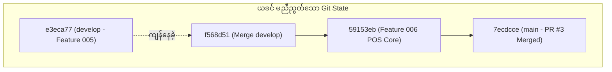

# Git History ချောမွေ့သန့်ရှင်းစေခြင်းနှင့် Branch များ ပြန်လည်ညှိနှိုင်းခြင်း မှတ်တမ်း (Git History & Branch Synchronization)

> [!IMPORTANT]
> ### ⚠️ Git Branch & Commit Reminder Alert (Git Branch နှင့် Commit သတိပေးချက်)
> **လက်ရှိ Active ဖြစ်နေသော Git Branch**: `develop`
> 
> စနစ်ပြင်ဆင်မှုများ မစတင်မီ မိမိရောက်ရှိနေသော Git Branch အား သေချာစွာ စစ်ဆေးပေးပါရန် သတိပေးအပ်ပါသည်။
> 
> **Suggested Conventional Commit Message:**
> ```text
> docs(git): document branch synchronization and git history workflow alignment
> ```
> 
> **Ready-to-run Git Command:**
> ```bash
> cd backendPos
> git add .
> git commit -m "docs(git): document branch synchronization and git history workflow alignment"
> ```

---

## ၁။ ပြဿနာ တွေ့ရှိချက် အနှစ်ချုပ် (Issue Overview)

စနစ်၏ Git history နှင့် branch အခြေအနေများကို စစ်ဆေးရာတွင် အောက်ပါ အချက်များကို တွေ့ရှိခဲ့ရပါသည်-

1. **Workspace Root vs Backend Git Path မတူညီခြင်း**:
   - Project ၏ `.git` directory သည် `backendPos/.git` တွင် တည်ရှိနေပြီး၊ root directory (`resturant-pos`) တွင် Git init ပြုလုပ်မထားပါ။
   - ထို့ကြောင့် Terminal တွင် `cd backendPos` မဝင်ဘဲ root မှ `git status` ခေါ်ယူပါက `fatal: not a git repository` ဟု error ပေါ်ပေါက်ရခြင်း ဖြစ်ပါသည်။
2. **`develop` Branch နှင့် `main` Branch ကွဲလွဲနေခြင်း (Branch Desynchronization)**:
   - Feature Branch ဖြစ်သည့် `feature/develop/006-Dining-Table-Management-Dynamic-QR-Code-Generator` (Dining Table, QR Code, Cash Drawer, Cashier Checkout, Staff Orders စသည့် code ဖိုင်ပေါင်း ၆၅ ခုနှင့် code စာကြောင်းရေ ၁၄,၀၈၀ ကျော်) သည် GitHub ပေါ်တွင် Pull Request #3 မှတစ်ဆင့် `main` branch ထဲသို့ တိုက်ရိုက် merge ပြုလုပ်ပြီးဖြစ်ခဲ့သည်။
   - သို့သော် `develop` branch သည် အဆိုပါ commit များကို မရရှိသေးဘဲ ရှေးယခင် Feature 005 (Expense Tracker) အဆင့် `e3eca77` တွင်သာ ရပ်တန့်ကျန်နေခဲ့သည်။
   - အကျိုးဆက်အနေဖြင့် `develop` branch သို့ switch လုပ်လိုက်ပါက Feature 006 ၏ POS code များ ပျောက်ကွယ်နေခဲ့ပါသည်။

---

## ၂။ အရင်းခံ အကြောင်းရင်း (Root Cause Analysis)



- Pull Request #3 ကို `main` သို့ တိုက်ရိုက် merge လုပ်ခဲ့သော်လည်း Standard Git Flow အတိုင်း `develop` သို့ ပြန်လည် sync (Fast-Forward Merge) မပြုလုပ်ရသေးသောကြောင့် ဖြစ်ပါသည်။
- `e3eca77` (develop) သည် `7ecdcce` (main) ၏ တိုက်ရိုက်ဘိုးဘေး (Direct Ancestor) ဖြစ်သောကြောင့် မည်သည့် conflict မျှ မရှိဘဲ သန့်ရှင်းချောမွေ့စွာ Fast-Forward ပြုလုပ်နိုင်သော အခြေအနေ ဖြစ်ပါသည်။

---

## ၃။ အဆင့်ဆင့် ဖြေရှင်းခဲ့ပုံ (Step-by-Step Resolution)

### အဆင့် (၁) - `develop` Branch အား `main` နှင့် Fast-Forward Merge ပြုလုပ်ခြင်း

```bash
cd backendPos
git checkout develop
git merge --ff-only main
```
- **ရလဒ်**: Merge Conflict လုံးဝမရှိဘဲ `Updating e3eca77..7ecdcce (Fast-forward)` အောင်မြင်စွာ ပြီးမြောက်ခဲ့သည်။
- ဖိုင်ပေါင်း ၆၅ ခု (Controllers, Models, Requests, Resources, Views, Tests, Migrations) သည် `develop` ထဲသို့ ၁၀၀% အပြည့်အဝ ရောက်ရှိသွားပါသည်။

### အဆင့် (၂) - Git Status နှင့် Commit Tree ပြန်လည်စစ်ဆေးခြင်း

```bash
git log --graph --oneline -n 10
```
- `develop` နှင့် `main` နှစ်ခုစလုံးသည် တူညီသော commit `7ecdcce` တွင် တပြေးညီ ရပ်တည်သွားပြီး Git History သည် ရှင်းလင်းဖြောင့်ဖြူး (Smooth & Clean) သွားပါသည်။

---

## ၄။ စမ်းသပ်စစ်ဆေးခြင်း ရလဒ်များ (Verification & Quality Assurance)

1. **Automated Feature & Unit Tests**:
   - `php artisan test`
   - **140 Tests Passed (747 Assertions)** - ၁၀၀% အောင်မြင်ပါသည်။
2. **Laravel Pint Code Styling Check**:
   - `./vendor/bin/pint --test`
   - **Passed** - PSR-12 code standards အပြည့်အဝ ကိုက်ညီပါသည်။

---

## ၅။ Remote သို့ အပြောင်းအလဲများ တင်ပို့ရန် အကြံပြုချက် (Push & Next Steps)

Local `develop` သည် `origin/develop` ထက် 4 commits ရှေ့ရောက်နေသဖြင့် အောက်ပါ command ဖြင့် GitHub remote သို့ push လုပ်နိုင်ပါသည်:

```bash
cd backendPos
git push origin develop
```
