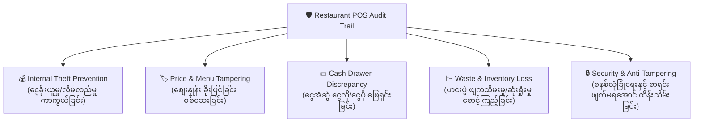
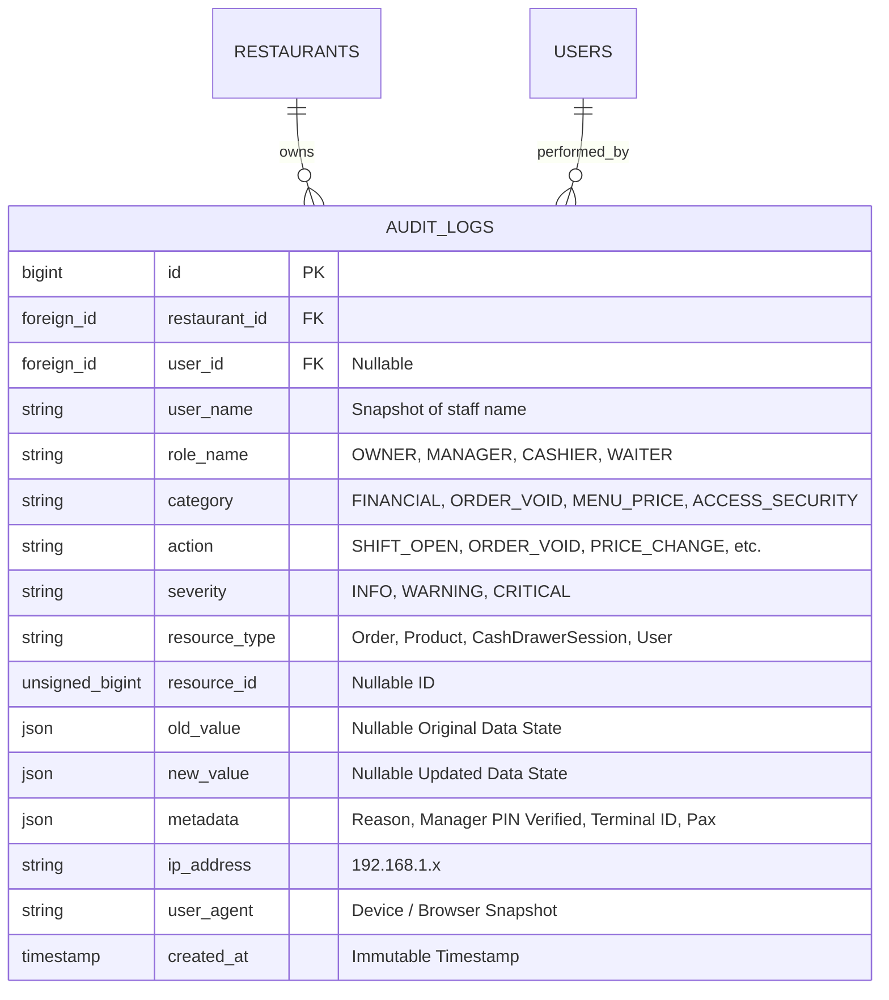

# စားသောက်ဆိုင် POS စနစ် Audit Logs လိုအပ်ချက်များနှင့် လုံခြုံရေး ဗိသုကာ (Restaurant POS Audit Logs System Requirements & Architecture)

> [!IMPORTANT]
> ### ⚠️ Git Branch & Commit Reminder Alert (Git Branch နှင့် Commit သတိပေးချက်)
> **လက်ရှိ Active ဖြစ်နေသော Git Branch**: `feature/develop/007-audit-logs`
> 
> စနစ်ပြင်ဆင်မှုများ မစတင်မီ မိမိရောက်ရှိနေသော Git Branch အား သေချာစွာ စစ်ဆေးပေးပါရန် သတိပေးအပ်ပါသည်။
> 
> **Suggested Conventional Commit Message:**
> ```text
> docs(audit): define comprehensive restaurant pos audit logs requirements and architecture
> ```
> 
> **Ready-to-run Git Command:**
> ```bash
> cd backendPos
> git add .
> git commit -m "docs(audit): define comprehensive restaurant pos audit logs requirements and architecture"
> ```

---

## 📌 နိဒါန်း (Introduction)

ဤစာတမ်းသည် Restaurant POS စနစ်၏ Admin Portal ဖြစ်သော **`http://localhost:8085/admin/audit-logs`** (Audit Trail & Activity Log Module) တည်ဆောက်ရန်အတွက် လိုအပ်ချက်များ (Requirements)၊ အဘယ်ကြောင့် အသုံးပြုရသည် (Why) နှင့် လက်တွေ့ စားသောက်ဆိုင် လုပ်ငန်းခွင်တွင် အသုံးချမည့် နည်းပညာ ဗိသုကာ (Architecture & Implementation Plan) တို့ကို မြန်မာဘာသာဖြင့် အသေးစိတ် ရှင်းလင်းမှတ်တမ်းတင်ထားခြင်း ဖြစ်ပါသည်။

---

## ၁။ အဘယ်ကြောင့် စားသောက်ဆိုင် POS တွင် Audit Logs သည် မရှိမဖြစ် လိုအပ်သနည်း? (Why Audit Logs are Essential for Restaurant POS)

စားသောက်ဆိုင် လုပ်ငန်းသည် ငွေသား (Cash) နှင့် ဒစ်ဂျစ်တယ်ငွေပေးချေမှု (Digital Pay) များ နေ့စဉ် အများအပြား ဝင်ထွက်လှုပ်ရှားပြီး ဝန်ထမ်းအဆင့်ဆင့် (Waiters, Cashiers, Kitchen Staff, Floor Managers) အလုပ်ရှုပ်စွာ လည်ပတ်ရသော လုပ်ငန်းဖြစ်ပါသည်။ ထို့ကြောင့် Audit Logs မရှိပါက အောက်ပါ ဆုံးရှုံးမှုများနှင့် အန္တရာယ်များ ဖြစ်ပေါ်နိုင်ပါသည်:



### (က) အတွင်းလူ ငွေခိုးယူမှုနှင့် လိမ်လည်မှု ကာကွယ်ခြင်း (Internal Theft & Fraud Prevention)
1. **Sweethearting & Bill Voiding Theft (ဘေလ်ဖျက်ပြီး ငွေလိမ်ယူမှု)**:
   - Cashier သည် ဧည့်သည်ထံမှ ကျသင့်ငွေ (ဥပမာ: `65,000 MMK`) အား ငွေသားဖြင့် အပြည့်လက်ခံပြီးနောက်၊ ဧည့်သည် ထွက်သွားချိန်တွင် စနစ်ထဲ၌ အဆိုပါ Order အား "VOID" (ဖျက်သိမ်းခြင်း) သို့မဟုတ် Item အားလုံးကို Cancel လုပ်ကာ ငွေသားကို အိတ်ကပ်ထဲ ထည့်ယူတတ်ကြပါသည်။
   - **Audit Logs အခန်းကဏ္ဍ**: မည်သည့် Order ကို မည်သူက မည်သည့်အချိန်တွင် ဖျက်ခဲ့သည်၊ မန်နေဂျာ မည်သူက PIN ဖြင့် ခွင့်ပြုပေးခဲ့သည်၊ ဖျက်ရသည့် အကြောင်းပြချက် (Reason) အား မှတ်တမ်းတင်ထားသဖြင့် လိမ်လည်မှုများကို ချက်ချင်း ဖမ်းဆီးနိုင်ပါသည်။
2. **No-Sale Cash Drawer Kicking (အော်ဒါမရှိဘဲ ငွေအံဆွဲဖွင့်မှု)**:
   - အော်ဒါမရိုက်ဘဲ ခလုတ်နှိပ်ကာ ငွေအံဆွဲကို မကြာခဏဖွင့်ပြီး ငွေယူခြင်းများကို သိရှိနိုင်ရန် `DRAWER_KICK_NO_SALE` အကြိမ်ရေနှင့် အချိန်ကို စောင့်ကြည့်ရပါမည်။

### (ခ) ဟင်းပွဲ စျေးနှုန်းနှင့် လျှော့စျေး ခိုးပြင်ခြင်း ကာကွယ်ခြင်း (Price Manipulation & Unauthorized Discounts)
- ဝန်ထမ်းတစ်ဦးက မိမိမိတ်ဆွေအား ဟင်းပွဲစျေးနှုန်း `15,000 MMK` တန်ကို ခေတ္တ `5,000 MMK` သို့ လျှော့ချရိုက်ပေးခြင်း သို့မဟုတ် အထူး Discount 50% ခွင့်ပြုချက်မရှိဘဲ ပေးလိုက်ခြင်းများကို ခြေရာခံနိုင်ရပါမည်။
- Audit Logs သည် မူလတန်ဖိုး (Old Value) နှင့် ပြင်ဆင်လိုက်သော တန်ဖိုး (New Value) တို့ကို တိကျစွာ နှိုင်းယှဉ်သိမ်းဆည်းပေးပါသည်။

### (ဂ) အဆိုင်းလဲချိန် ငွေစာရင်း ကွာဟမှု တာဝန်ယူနိုင်ခြင်း (Shift Handover Accountability)
- Cashier A မှ Cashier B သို့ အဆိုင်းလွှဲပြောင်းချိန်တွင် ငွေအံဆွဲအတွင်းရှိ ငွေသား (Cash Count) သည် POS စနစ် စာရင်း (Expected Cash) ထက် လိုနေပါက (Cash Shortage) မည်သည့် အဆိုင်း၊ မည်သည့် ဝန်ထမ်းလက်ထက်တွင် မည်သည့် လွှဲမှားမှုဖြစ်ခဲ့သည်ကို အငြင်းပွားဖွယ်မရှိ သက်သေပြနိုင်ပါသည်။

### (ဃ) စာရင်းဖျက်၍မရသော သစ္စာရှိ မှတ်တမ်း (Immutable Audit Trail)
- Audit Logs စာရင်းအား မည်သည့် Admin သို့မဟုတ် Manager မျှ ပြင်ဆင်ခွင့် (Update) သို့မဟုတ် ဖျက်ပစ်ခွင့် (Delete) မရှိစေဘဲ **Append-Only (အသစ်ထပ်တိုးရုံသာ)** ပြုလုပ်ထားသောကြောင့် တရားရုံး သို့မဟုတ် စာရင်းစစ် (Audit) အဖွဲ့များရှေ့တွင် ၁၀၀% ယုံကြည်စိတ်ချရပါသည်။

---

## ၂။ `http://localhost:8085/admin/audit-logs` အတွက် အဓိက လိုအပ်ချက်များ (System Requirements)

Audit Logs Module တစ်ခု ပြည့်စုံရန်အတွက် အောက်ပါ လုပ်ဆောင်ချက် လိုအပ်ချက်များ (Functional Requirements) နှင့် နည်းပညာ လိုအပ်ချက်များ (Technical Requirements) အားလုံး ပါဝင်ရပါမည်:

### ၂.၁။ စောင့်ကြည့် မှတ်တမ်းတင်ရမည့် Event အမျိုးအစား (၄) မျိုး (Core Event Categories)

| အမျိုးအစား (Category) | Event Action | ဖော်ပြချက် (Description) & သိမ်းဆည်းမည့် အချက်အလက် |
| :--- | :--- | :--- |
| **၁။ ငွေကြေးနှင့် ငွေအံဆွဲ<br>(Financial & Cash Drawer)** | `SHIFT_OPEN` | စတင် အဆိုင်းဖွင့်ချိန်နှင့် အစပျိုး ထည့်ဝင်ငွေ (Opening Float MMK)။ |
| | `SHIFT_CLOSE` | အဆိုင်းပိတ်ချိန်၊ စနစ်တွက်ချက်ငွေနှင့် အမှန်တကယ် ရေတွက်ရရှိငွေ (Discrepancy MMK)။ |
| | `DRAWER_KICK_NO_SALE` | အရောင်းအော်ဒါမရှိဘဲ ငွေအံဆွဲအား ဖွင့်လှစ်ခဲ့သော အကြိမ်များ။ |
| | `CASH_IN` / `CASH_OUT` | ငွေအံဆွဲအတွင်းသို့ ငွေအပိုထည့်ခြင်း သို့မဟုတ် အရေးပေါ် ငွေထုတ်ယူ သုံးစွဲခြင်း (Petty Cash)။ |
| | `PAYMENT_REFUND` | ငွေပေးချေပြီးသော ဘေလ်အား ငွေပြန်အမ်းခြင်း (Refund Amount MMK, Reason)။ |
| **၂။ အော်ဒါနှင့် ဘေလ်ဖျက်သိမ်းမှု<br>(Order, Billing & Voids)** | `ORDER_VOID` | အော်ဒါတစ်ခုလုံးအား ဖျက်သိမ်းခြင်း (Manager PIN, Reason, Total Voided MMK)။ |
| | `ITEM_CANCEL` | မီးဖိုချောင်သို့ ပို့ပြီးသော ဟင်းပွဲအား ဖျက်သိမ်းခြင်း (Kitchen Waste / Spoilage)။ |
| | `DISCOUNT_APPLIED` | ဘေလ်ပေါ်တွင် Manual Discount လျှော့ပေးခြင်း (Discount %, Amount MMK, Approved By)။ |
| | `TABLE_TRANSFER` | ဧည့်သည် စားပွဲခုံ ပြောင်းရွှေ့ခြင်း (Old Table ➡️ New Table)။ |
| | `REPRINT_RECEIPT` | ပြေစာစလစ်အား ထပ်မံ ထုတ်ဝေခြင်း (Duplicate Bill Fraud စောင့်ကြည့်ရန်)။ |
| **၃။ မီနူးနှင့် စျေးနှုန်း ပြင်ဆင်မှု<br>(Catalog & Price Changes)** | `PRICE_CHANGE` | ဟင်းပွဲ ရောင်းစျေး/ဝယ်စျေး ပြောင်းလဲခြင်း (Old Price MMK ➡️ New Price MMK)။ |
| | `PRODUCT_CREATE` | ဟင်းပွဲအသစ် ထည့်သွင်းခြင်း (Dish Name, Category, Base Price MMK)။ |
| | `PRODUCT_DELETE` | မီနူးစာရင်းမှ ဟင်းပွဲအား ဖျက်ထုတ်ခြင်း။ |
| | `RECIPE_COST_UPDATE` | ဟင်းပွဲ ကုန်ကြမ်းပါဝင်မှုနှင့် ကုန်ကျစရိတ် ပြင်ဆင်ခြင်း။ |
| **၄။ လုံခြုံရေးနှင့် ဝန်ထမ်းအသုံးပြုမှု<br>(Security & Auth Access)** | `AUTH_LOGIN` / `LOGOUT` | စနစ်သို့ ဝန်ထမ်း အကောင့်ဝင်ရောက်ခြင်းနှင့် ထွက်ခွာခြင်း (IP, Device)။ |
| | `AUTH_FAILED` | စကားဝှက် သို့မဟုတ် Manager PIN မှားယွင်းစွာ ရိုက်နှိပ် ကြိုးစားမှုများ။ |
| | `PERMISSION_CHANGED` | ဝန်ထမ်း၏ Role သို့မဟုတ် Permission များအား ပြောင်းလဲသတ်မှတ်ခြင်း။ |
| | `SETTINGS_UPDATE` | ဆိုင်ဆက်တင်များ၊ Service Charge % သို့မဟုတ် Tax % ပြင်ဆင်ခြင်း။ |

---

### ၂.၂။ အန္တရာယ်အဆင့် သတ်မှတ်ချက်များ (Severity Level Classification)

Audit Logs တစ်ခုချင်းစီကို စီမံခန့်ခွဲသူ (Owner/Manager) က ချက်ချင်း အကဲဖြတ်နိုင်ရန် အဆင့် (၃) ဆင့် ခွဲခြားပါသည်:

1. 🟢 **`INFO` (အခြေခံ မှတ်တမ်း)**:
   - ပုံမှန် အကောင့်ဝင်ခြင်း (`AUTH_LOGIN`)၊ စားပွဲခုံရွှေ့ခြင်း (`TABLE_TRANSFER`)၊ အဆိုင်းဖွင့်ခြင်း (`SHIFT_OPEN`)။
2. 🟡 **`WARNING` (သတိပြုရမည့် မှတ်တမ်း)**:
   - ဟင်းပွဲစျေးနှုန်း ပြင်ဆင်ခြင်း (`PRICE_CHANGE`)၊ ကုန်ကြမ်းဆုံးရှုံးမှု (`ITEM_CANCEL`)၊ စလစ် ထပ်မံထုတ်ယူခြင်း (`REPRINT_RECEIPT`)။
3. 🔴 **`CRITICAL` (ချက်ချင်း စစ်ဆေးရမည့် အရေးကြီး မှတ်တမ်း)**:
   - ဘေလ်တစ်ခုလုံး ဖျက်သိမ်းခြင်း (`ORDER_VOID`)၊ အော်ဒါမရှိဘဲ ငွေအံဆွဲဖွင့်ခြင်း (`DRAWER_KICK_NO_SALE`)၊ PIN မှားယွင်းမှု အကြိမ်ကြိမ်ဖြစ်ခြင်း (`AUTH_FAILED`)၊ ငွေပြန်အမ်းခြင်း (`PAYMENT_REFUND`)။

---

## ၃။ UI / UX ဒီဇိုင်း လိုအပ်ချက်များ (`http://localhost:8085/admin/audit-logs`)

စနစ်စည်းမျဉ်း (Rule 5 & Rule 6) အတိုင်း တည်ဆောက်ရမည့် UI အစိတ်အပိုင်းများ:

```
+-------------------------------------------------------------------------------------------------------+
|  📜 Audit Logs & Security Trails                          [ 🟢 Live Real-time ] [ 📥 Export CSV/PDF ]   |
|  Comprehensive immutable tracking of all restaurant cash, voids, prices, and staff operations          |
+-------------------------------------------------------------------------------------------------------+
|  [ 📊 Total Audits ]         [ 🔴 Critical Alerts ]      [ 🧾 Voids & Refunds ]    [ 💵 Cash Discrepancy ] |
|      1,428 Records                 12 Incidents                 45,000 MMK                -3,500 MMK          |
+-------------------------------------------------------------------------------------------------------+
|  FILTERS:                                                                                             |
|  [ 📅 Date Range: Today ] [ 🏷️ Category: All ] [ ⚠️ Severity: All ] [ 👤 Staff: All ] [ 🔍 Search... ]   |
+-------------------------------------------------------------------------------------------------------+
|  Timestamp   | Staff / Role      | Category   | Action        | Details / Diff              | Severity|
|--------------+-------------------+------------+---------------+-----------------------------+---------|
| 18:42:15     | Aung Aung         | Financial  | ORDER_VOID    | Order #ORD-1082 (65,000 MMK)| 🔴 CRIT |
|              | Cashier           |            |               | Reason: Guest Left Without  |         |
|--------------+-------------------+------------+---------------+-----------------------------+---------|
| 17:15:02     | Ko Zaw            | Menu/Price | PRICE_CHANGE  | Shan Noodle Special         | 🟡 WARN |
|              | Manager           |            |               | 3,500 MMK ➡️ 4,000 MMK      |         |
|--------------+-------------------+------------+---------------+-----------------------------+---------|
| 15:30:00     | Su Su             | Financial  | NO_SALE_KICK  | Cash Drawer #1 Opened       | 🔴 CRIT |
|              | Cashier           |            |               | Manual Button Press         |         |
|--------------+-------------------+------------+---------------+-----------------------------+---------|
| 09:00:10     | Kyaw Min          | Access     | SHIFT_OPEN    | Register #1 Opened          | 🟢 INFO |
|              | Head Cashier      |            |               | Float: 100,000 MMK          |         |
+-------------------------------------------------------------------------------------------------------+
```

### UI အသွင်အပြင် အဓိက သတ်မှတ်ချက်များ:
1. **Typography & Styling**:
   - `font-family: "Mada", sans-serif;` ကို တစ်သမတ်တည်း အသုံးပြုရမည်။
   - Dark Slate / Obsidian Theme (`--bg-body: #0b0f17`, `--bg-card: #161e2e`, `--border-color: #222d42`) ဖြင့် ခေတ်မီဆန်းသစ်ပြီး မျက်စိမညောင်းစေရပါ။
   - Accent Color အဖြစ် Brand Lime Green (`#9ec63b`) ကို အသုံးပြုရမည်။
2. **Interactive Diff Drawer / Modal (တန်ဖိုး အဟောင်း/အသစ် နှိုင်းယှဉ်ချက်)**:
   - စာကြောင်းတစ်ခုပေါ် နှိပ်လိုက်ပါက Modal သို့မဟုတ် Drawer ပွင့်လာပြီး မူလတန်ဖိုး (`old_value`) နှင့် ပြောင်းလဲတန်ဖိုး (`new_value`) ကို JSON ပုံစံဖြင့်ဖြစ်စေ၊ Side-by-Side ရှင်းလင်းစွာဖြစ်စေ ပြသပေးရပါမည်။
3. **ငွေကြေး ပြသမှု (Burmese Kyats Rule)**:
   - ငွေကြေးပမာဏ မှန်သမျှကို ဒသမကိန်းမပါဘဲ ထောင်ဂဏန်းကော်မာဖြင့် ဖော်ပြရမည် (ဥပမာ: `65,000 MMK`, `3,500 MMK`)။

---

## ၄။ ဒေတာဘေ့စ် ဖွဲ့စည်းပုံနှင့် Schema Architecture (Database Schema)

လက်ရှိ `audit_logs` ဇယားကို ပိုမိုစုံလင် ခိုင်မာစေရန် အောက်ပါအတိုင်း ဖွဲ့စည်းရပါမည်:



### Data Dictionary & Fields ရှင်းလင်းချက်:
- **`user_name` & `role_name`**: အသုံးပြုသူ User အကောင့် နောင်တွင် ဖျက်ပစ်ခံရသော်လည်း သမိုင်းကြောင်း မပျောက်ပျက်စေရန် Snapshot အဖြစ် သိမ်းဆည်းခြင်း။
- **`old_value` & `new_value` (JSON)**: ပြင်ဆင်မှု မတိုင်မီနှင့် ပြင်ဆင်ပြီး အခြေအနေတို့ကို သိမ်းဆည်းသော JSON အကွက်များ။
- **`metadata` (JSON)**: အရေးကြီး အချက်အလက်များဖြစ်သည့် (ဥပမာ: Manager PIN အတည်ပြုချက်၊ Void ပြုလုပ်ရသည့် အကြောင်းပြချက်၊ ပရင်တာ အခြေအနေ စသည်)။
- **`severity`**: စီစစ်ရ လွယ်ကူစေရန် အရောင်ကုဒ် ခွဲခြားသတ်မှတ်ခြင်း။

---

## ၅။ Backend Architecture: Form Requests & API Resources သတ်မှတ်ချက် (Rule 4)

စနစ်၏ စည်းမျဉ်း (Rule 4: Mandatory Form Requests & API Resources) အရ Controller ထဲတွင် Inline Validation လုံးဝ မရေးသားဘဲ အောက်ပါအတိုင်း ခွဲခြား တည်ဆောက်ရပါမည်:

### ၅.၁။ Dedicated Form Request: `app/Http/Requests/Admin/AuditLogFilterRequest.php`
- ရွေးချယ်နိုင်သော Filter ကန့်သတ်ချက်များ (Date Range, Category, Severity, Staff, Search Term, Per Page Limit) ကို သီးခြား စစ်ဆေးပေးပါသည်။

```php
namespace App\Http\Requests\Admin;

use Illuminate\Foundation\Http\FormRequest;

class AuditLogFilterRequest extends FormRequest
{
    public function authorize(): bool
    {
        return $this->user()?->hasRole('OWNER') ?? false;
    }

    public function rules(): array
    {
        return [
            'date_from' => 'nullable|date',
            'date_to' => 'nullable|date|after_or_equal:date_from',
            'category' => 'nullable|string|in:FINANCIAL,ORDER_VOID,MENU_PRICE,ACCESS_SECURITY',
            'severity' => 'nullable|string|in:INFO,WARNING,CRITICAL',
            'user_id' => 'nullable|integer|exists:users,id',
            'search' => 'nullable|string|max:100',
            'per_page' => 'nullable|integer|min:10|max:100',
        ];
    }
}
```

### ၅.၂။ Dedicated API Resource: `app/Http/Resources/Admin/AuditLogResource.php`
- Audit Record တစ်ခုချင်းစီကို Formatting လုပ်ပြီး Frontend သို့ သန့်ရှင်းစွာ ပေးပို့ပါသည်။

```php
namespace App\Http\Resources\Admin;

use Illuminate\Http\Request;
use Illuminate\Http\Resources\Json\JsonResource;

class AuditLogResource extends JsonResource
{
    public function toArray(Request $request): array
    {
        return [
            'id' => $this->id,
            'user_name' => $this->user_name ?? 'System Automated',
            'role_name' => $this->role_name ?? 'N/A',
            'category' => $this->category,
            'action' => $this->action,
            'severity' => $this->severity,
            'resource_type' => $this->resource_type,
            'resource_id' => $this->resource_id,
            'old_value' => $this->old_value,
            'new_value' => $this->new_value,
            'metadata' => $this->metadata,
            'ip_address' => $this->ip_address,
            'currency' => 'MMK',
            'created_at_human' => $this->created_at?->diffForHumans(),
            'created_at_formatted' => $this->created_at?->format('d/m/Y h:i:s A'),
        ];
    }
}
```

### ၅.၃။ Audit Logging Helper / Service: `app/Services/AuditLogService.php`
- POS စနစ်၏ မည်သည့်နေရာမှမဆို (Cashier Controller, Waiter Controller, Menu Controller) လိုင်းတစ်လိုင်းတည်းဖြင့် အလွယ်တကူ Log မှတ်နိုင်စေရန် Helper Service ဖန်တီးခြင်း:
```php
AuditLogService::log(
    action: 'ORDER_VOID',
    category: 'ORDER_VOID',
    severity: 'CRITICAL',
    resource: $order,
    oldValue: ['total' => 65000, 'status' => 'PENDING'],
    newValue: ['status' => 'VOIDED'],
    metadata: ['manager_pin_verified' => true, 'reason' => 'Guest left due to flight schedule']
);
```

---

## ၆။ အဆင့်ဆင့် အကောင်အထည်ဖော်မည့် လမ်းပြမြေပုံ (Step-by-Step Implementation Roadmap)

စနစ်အား လက်တွေ့ တည်ဆောက်ရာတွင် အောက်ပါ အဆင့် (၅) ဆင့်ဖြင့် စနစ်တကျ အကောင်အထည်ဖော်ဆောင်ရွက်မည် ဖြစ်ပါသည်:

1. **Step 1: Database Migration Enhancement**:
   - `audit_logs` ဇယားတွင် `category`, `severity`, `role_name`, `metadata` column များ ဖြည့်စွက်ခြင်း (မရှိသေးပါက migration အသစ်ရေးခြင်း)။
2. **Step 2: Service Layer & Activity Observer**:
   - `AuditLogService` ရေးသားပြီး Cashier Shift၊ Order Void၊ Product Price Change အဖြစ်အပျက်များတွင် အလိုအလျောက် Log သိမ်းဆည်းရန် ချိတ်ဆက်ခြင်း။
3. **Step 3: Controller, Request & Resource**:
   - `AuditLogController` တည်ဆောက်ခြင်း၊ `AuditLogFilterRequest` နှင့် `AuditLogResource` ဖန်တီးခြင်း။
   - Route `http://localhost:8085/admin/audit-logs` အား Placeholder View အစား Real Interactive View သို့ ချိတ်ဆက်ခြင်း။
4. **Step 4: Modern Blade UI Dashboard**:
   - Mada Font၊ Dark Slate Theme၊ KPI ၄ ကတ်၊ Live Filter နှင့် Old/New JSON Diff Viewer တို့ပါဝင်သော `resources/views/admin/audit-logs/index.blade.php` ဖန်တီးခြင်း။
   - CSV Export စနစ် ထည့်သွင်းခြင်း။
5. **Step 5: Strict Verification & Tests (Rule 3)**:
   - `php artisan test tests/Feature/Admin/AuditLogSystemTest.php` ဖြင့် Feature စမ်းသပ်မှုများ ပြုလုပ်၍ ၁၀၀% အောင်မြင်အောင် ဆောင်ရွက်ခြင်း။

---

## ၇။ အကျဉ်းချုပ် (Summary)

ဤ Audit Logs စနစ်သည် စားသောက်ဆိုင် ပိုင်ရှင် (Restaurant Owner) အတွက် **ငွေကြေးယိုဖိတ်မှု ကင်းဝေးစေရေး၊ ဝန်ထမ်းများ၏ လိမ်လည်မှုအား ကြိုတင်ကာကွယ်ရေးနှင့် ဆိုင်တွင်း စစ်ဆေးမှု (Internal Control) အဆင့်အတန်း မြင့်မားစေရေး** တို့အတွက် အရေးကြီးဆုံးသော ကျောရိုးလုံခြုံရေး မဏ္ဍိုင် (Core Security Pillar) ဖြစ်ပါသည်။

---

## ၈။ စနစ်တည်ဆောက်ပြီးစီးမှုနှင့် စမ်းသပ်မှု မှတ်တမ်း (Implementation & Verification Evidence)

အောက်ပါ အစိတ်အပိုင်းများအားလုံး ၁၀၀% တည်ဆောက်ပြီးစီးပြီး စမ်းသပ်စစ်ဆေးပြီး ဖြစ်ပါသည်:

1. **Database Migration**:
   - `database/migrations/2026_09_28_000001_enhance_audit_logs_table.php` (`category`, `severity`, `role_name`, `metadata`, `user_agent` ဖြည့်စွက်ပြီး index များ ချိတ်ဆက်ခဲ့သည်)။
2. **Model & Service**:
   - `app/Models/AuditLog.php`: Scopes (`forRestaurant`, `filter`), Casts (`metadata => array`), Severity Color helpers။
   - `app/Services/AuditLogService.php`: Log entry များအား uniform စွာ မှတ်တမ်းတင်ပေးသည့် helper service။
3. **Form Request & API Resource (Rule 4)**:
   - `app/Http/Requests/Admin/AuditLogFilterRequest.php`: Authorization နှင့် multi-criteria filter validation rules။
   - `app/Http/Resources/Admin/AuditLogResource.php`: Currency MMK formatting နှင့် safe output transformation။
4. **Controller & Web Routes**:
   - `app/Http/Controllers/Web/AuditLogController.php`: `index`, `apiData`, `show`, `exportCsv` endpoints။
   - `routes/web.php`: Route name `admin.audit.logs` (`http://localhost:8085/admin/audit-logs`) အား အောင်မြင်စွာ ချိတ်ဆက်ပြီးစီး။
5. **Modern Blade UI (Rule 5 & Rule 6)**:
   - `resources/views/admin/audit-logs/index.blade.php`: Mada typography၊ Obsidian dark slate palette၊ 4 KPI cards၊ live search filter၊ Old/New state diff viewer နှင့် metadata inspection modal။
6. **Automated Test Results (Rule 3)**:
   - `tests/Feature/Admin/AuditLogSystemTest.php`: ၉ ခုစလုံး ၁၀၀% Pass (52 assertions)။
   - Full Test Suite: **149 passed (799 assertions)** with 0 failures။
   - Code Style: **Laravel Pint PASS (180 files)**။

