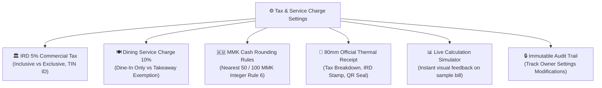
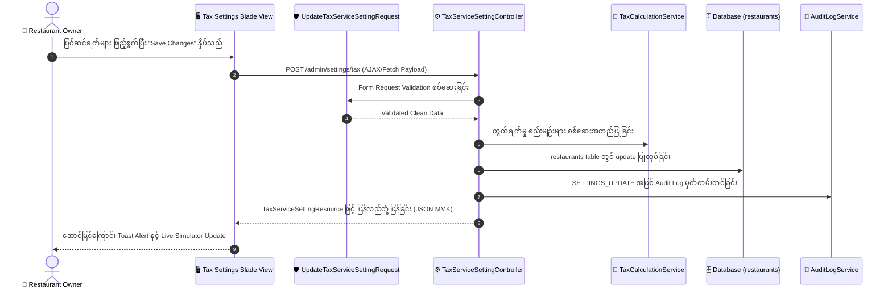

# စားသောက်ဆိုင် POS စနစ် အခွန်နှင့် ဝန်ဆောင်ခ ဆက်တင်များ စီမံခန့်ခွဲမှု လိုအပ်ချက်များနှင့် ဗိသုကာ (Tax & Service Charge Settings Module Requirements & Architecture)

> [!IMPORTANT]
> ### ⚠️ Git Branch & Commit Reminder Alert (Git Branch နှင့် Commit သတိပေးချက်)
> **လက်ရှိ Active ဖြစ်နေသော Git Branch**: `feature/develop/012-tax-service-setting`
> 
> စနစ်ပြင်ဆင်မှုများ မစတင်မီ မိမိရောက်ရှိနေသော Git Branch အား သေချာစွာ စစ်ဆေးပေးပါရန် သတိပေးအပ်ပါသည်။
> 
> **Suggested Conventional Commit Message:**
> ```text
> docs(tax-settings): define tax and service charge settings requirements and architecture
> ```
> 
> **Ready-to-run Git Command:**
> ```bash
> cd backendPos
> git add .
> git commit -m "docs(tax-settings): define tax and service charge settings requirements and architecture"
> ```

---

## 📌 နိဒါန်း (Introduction)

ဤစာတမ်းသည် စားသောက်ဆိုင် POS စနစ်၏ Admin Executive Portal ဖြစ်သော **`https://res-backend-pos-khaki.vercel.app/admin/settings/tax`** (Tax & Service Charge Settings Module) တည်ဆောက်ရန်အတွက် လက်ရှိ Project စစ်ဆေးချက် (Current Audit)၊ အဘယ်ကြောင့် အသုံးပြုရသည် (Why)၊ အသေးစိတ် လုပ်ငန်းခွင် လိုအပ်ချက်များ (Comprehensive Requirements) နှင့် အဆင့်ဆင့် တည်ဆောက်မည့် နည်းပညာ ဗိသုကာ (Step-by-Step Implementation Blueprint) တို့ကို မြန်မာဘာသာဖြင့် စုံလင်ပြည့်စုံစွာ မှတ်တမ်းတင်ထားခြင်း ဖြစ်ပါသည်။

---

## ၁။ လက်ရှိ Codebase အခြေအနေ စစ်ဆေးချက် (Current System Audit)

လက်ရှိ `backendPos` စနစ်အား စစ်ဆေးခဲ့ရာတွင် အောက်ပါ အချက်အလက်များကို တွေ့ရှိရပါသည်:

1. **Route Mapping အခြေအနေ**:
   - `routes/web.php` (Line 52) တွင်:
     ```php
     Route::get('/settings/tax', [AdminModuleController::class, 'show'])->defaults('module', 'tax-settings')->name('settings.tax');
     ```
   - လက်ရှိတွင် `AdminModuleController` ၏ Placeholder View (`admin.modules.placeholder`) ကိုသာ ချိတ်ဆက်ထားပြီး အမှန်တကယ် ပြင်ဆင်သိမ်းဆည်းနိုင်သော UI သို့မဟုတ် POST/PUT Handler များ မရှိသေးပါ။
2. **Database Schema အခြေအနေ (`restaurants` Table)**:
   - `database/migrations/2026_09_29_000001_enhance_restaurant_settings_table.php` တွင် အခြေခံ အခွန်ကော်လံ အနည်းငယ်သာ ပါရှိပါသည်:
     - `tax_id` (အခွန်မှတ်ပုံတင်အမှတ်)
     - `show_tax_id_on_receipt` (ပြေစာပေါ်တွင် Tax ID ပြသရန်)
     - `default_tax_percent` (Default: 5.00)
     - `default_service_charge_percent` (Default: 5.00)
3. **ချို့ယွင်းနေသော မရှိမဖြစ် စားသောက်ဆိုင် အခွန်ဆိုင်ရာ စွမ်းဆောင်ရည်များ (Missing Critical Requirements)**:
   - **အခွန်တွက်ချက်မှု ပုံစံ (Tax Calculation Modes)**: မီနူးစျေးနှုန်းထဲတွင် အခွန်ပါပြီးဖြစ်သော **Inclusive Model (စျေးနှုန်းထဲ အခွန် ၅% ပါပြီး)** သို့မဟုတ် စုစုပေါင်းအပေါ် ထပ်ပေါင်းတွက်သော **Exclusive Model (Add-on Subtotal + 5%)** ရွေးချယ်နိုင်သော ဆက်တင် မရှိသေးပါ။
   - **ဝန်ဆောင်ခအပေါ် အခွန်ထပ်စည်းကြပ်မှု (Tax on Service Charge Rule)**: ကုန်သွယ်လုပ်ငန်းခွန်ကို မူလဘေလ်တန်ဖိုး အပေါ်တွင်သာ ကောက်ခံမည်လား၊ သို့မဟုတ် ဝန်ဆောင်ခ ၁၀% အပါအဝင် အားလုံးပေါင်းပေါ်တွင် ကောက်ခံမည်လား (Compounded Tax) ဟူသော ရွေးချယ်မှု မရှိသေးပါ။
   - **Service Channels ခွဲခြားမှု**: ထိုင်စား (Dine-in) သာ ဝန်ဆောင်ခ ကောက်ခံပြီး ပါဆယ် (Takeaway/Delivery) အတွက် ဝန်ဆောင်ခ ကင်းလွတ်ခွင့် ပေးနိုင်သော Toggle မရှိသေးပါ။
   - **မြန်မာကျပ်ငွေ Rounding စည်းမျဉ်း (MMK Cash Denomination Rounding)**: မြန်မာနိုင်ငံ စားသောက်ဆိုင်များတွင် ငွေအကြွေ ၁၀/၂၀ ကျပ် ရှားပါးသဖြင့် ငွေရှင်းရာတွင် အနီးစပ်ဆုံး ၅၀ ကျပ် သို့မဟုတ် ၁၀၀ ကျပ်သို့ ညှိနှိုင်းဖြတ်တောက်တွက်ချက်ပေးသော Rounding System မရှိသေးပါ။
   - **အဆင့်မြင့် အပူခံပြေစာ အခွန်စည်းကမ်း (80mm/58mm Thermal Receipt Compliance)**: ပြေစာပေါ်တွင် အခွန်ငွေပမာဏ၊ ဝန်ဆောင်ခပမာဏ၊ အခွန်ဦးစီးဌာန တံဆိပ်ခေါင်း / QR တံဆိပ်သီးသန့် ပြသမည့် Toggle များ မစုံလင်သေးပါ။
   - **အချိန်နှင့်တပြေးညီ တွက်ချက်ပြသမှု (Live Dynamic Bill Simulator)**: ဆိုင်ရှင်က အခွန် % သို့မဟုတ် ဝန်ဆောင်ခ % ပြောင်းလိုက်သည်နှင့် ဧည့်သည်၏ ဘေလ်ပြေစာတွင် မည်သို့ တွက်ချက်သွားမည်ကို မျက်မြင်ကိုယ်တွေ့ စမ်းသပ်ကြည့်ရှုနိုင်သော Live Previewer မရှိသေးပါ။

---

## ၂။ အဘယ်ကြောင့် စားသောက်ဆိုင် POS တွင် အခွန်နှင့် ဝန်ဆောင်ခ ဆက်တင်များ လိုအပ်သနည်း? (Why Tax & Service Settings are Essential)

စားသောက်ဆိုင် လုပ်ငန်းခွင်တွင် အခွန် (Commercial Tax) နှင့် ဝန်ဆောင်ခ (Service Charge) သည် ရိုးရိုး Form တစ်ခု မဟုတ်ဘဲ ဥပဒေရေးရာ လိုက်နာမှု၊ ဘဏ္ဍာရေး တိကျမှုနှင့် စားသုံးသူ စိတ်ကျေနပ်မှုတို့အတွက် အလွန်အရေးကြီးသော ဗဟိုအချက်အချာ ဖြစ်ပါသည်။



### (က) မြန်မာ့အခွန်ဦးစီးဌာန (IRD) စည်းမျဉ်းနှင့် ကုန်သွယ်လုပ်ငန်းခွန် ၅% တရားဝင်မှု
- မြန်မာနိုင်ငံ ပြည်တွင်းအခွန်များဦးစီးဌာန (Internal Revenue Department - IRD) ၏ စည်းမျဉ်းအရ စားသောက်ဆိုင်လုပ်ငန်းများသည် ရောင်းရငွေအပေါ် ကုန်သွယ်လုပ်ငန်းခွန် ၅% ကောက်ခံ၍ တရားဝင် အခွန်တံဆိပ်ခေါင်း (Tax Stamp) သို့မဟုတ် POS QR Code အမှတ်အသားပါသော ပြေစာကို စားသုံးသူထံ ထုတ်ပေးရပါမည်။
- ဆိုင်၏ အခွန်ထမ်းမှတ်ပုံတင်အမှတ် (TIN - Taxpayer Identification Number) နှင့် အခွန်ရုံးအမည်တို့ကို ပြေစာပေါ်တွင် တရားဝင် ထည့်သွင်းရိုက်နှိပ်ပေးရန် လိုအပ်ပါသည်။

### (ခ) Inclusive (အခွန်ပါပြီး) နှင့် Exclusive (အခွန်မပါသေးသော) စျေးနှုန်းစနစ်
- **Inclusive Pricing (ဧည့်သည်အကြိုက်)**: မီနူးတွင် ဖော်ပြထားသော စျေးနှုန်းအတိုင်း အတိအကျ ရှင်းရသည့် ပုံစံဖြစ်ပါသည် (ဥပမာ- ကြက်ကြော်တစ်ပွဲ ၁၀,၀၀၀ ကျပ်ဆိုလျှင် စားသုံးသူသည် ၁၀,၀၀၀ ကျပ်သာ ပေးရပြီး ဘေလ်တွင် အခြေခံတန်ဖိုး ၉,၅၂၄ ကျပ်နှင့် အခွန် ၄၇၆ ကျပ်အဖြစ် ခွဲခြမ်းပြသပေးခြင်း)။ ဘားများ၊ ကော်ဖီဆိုင်များနှင့် ခေတ်မီ Fast Casual ဆိုင်များတွင် အသုံးများပါသည်။
- **Exclusive Pricing (ဟိုတယ်နှင့် Fine Dining စတိုင်)**: မီနူးတွင် အခြေခံစျေးနှုန်းသာ ပြသပြီး စုစုပေါင်း ဘေလ်ရှင်းချိန်တွင် အခွန် ၅% နှင့် ဝန်ဆောင်ခ ၁၀% ကို အပေါ်မှ ထပ်ပေါင်းကောက်ခံသည့် ပုံစံဖြစ်ပါသည် (ဥပမာ- အစားအသောက် စုစုပေါင်း ၂၀,၀၀၀ ကျပ် + ဝန်ဆောင်ခ ၂,၀၀၀ ကျပ် + အခွန် ၁,၁၀၀ ကျပ် = ၂၃,၁၀၀ ကျပ်)။

### (ဂ) ထိုင်စား (Dine-In) နှင့် ပါဆယ် (Takeaway) ဝန်ဆောင်ခ မျှတမှု
- စားသောက်ဆိုင်တွင် လာရောက်ထိုင်စားသော ဧည့်သည်များသည် စားပွဲထိုးဝန်ဆောင်မှု၊ လေအေးပေးစက်နှင့် သန့်ရှင်းရေး ဝန်ဆောင်မှုများကို ရရှိသဖြင့် ဝန်ဆောင်ခ ၁၀% ပေးဆောင်ရန် သဘာဝကျသော်လည်း ပါဆယ် (Takeaway) သို့မဟုတ် Delivery မှာယူသော ဧည့်သည်များထံမှ ၁၀% ဝန်ဆောင်ခ ထပ်မံကောက်ခံပါက ဧည့်သည်များ မကျေမနပ်ဖြစ်စေနိုင်ပါသည်။
- ထို့ကြောင့် POS စနစ်တွင် ထိုင်စား (Dine-In) အတွက်သာ ဝန်ဆောင်ခ ကောက်ခံပြီး ပါဆယ်အတွက် ဝန်ဆောင်ခ ကင်းလွတ်ခွင့် (Auto-Exempt) ပေးနိုင်သော အသိဉာဏ်ရှိ ဆက်တင်များ ပါရှိရပါမည်။

### (ဃ) မြန်မာကျပ်ငွေ (MMK) အကြွေရှင်းလင်းမှု Rounding Rule (Rule 6 လိုက်နာမှု)
- မြန်မာနိုင်ငံ၏ လက်တွေ့ငွေသားလည်ပတ်မှုတွင် ၁ ကျပ်၊ ၅ ကျပ်၊ ၁၀ ကျပ်၊ ၂၀ ကျပ်တန် ငွေစက္ကူများနှင့် အကြွေစေ့များ သုံးစွဲမှု မရှိသလောက် ရှားပါးပါသည်။
- ရာခိုင်နှုန်းဖြင့် အခွန်တွက်ရာတွင် ထွက်ပေါ်လာသော ကျပ်စွန်းများ (ဥပမာ- ၃၁,၂၃၇ ကျပ်) ကို Cashier မှ အကြွေပြန်အမ်းရန် အခက်အခဲ မဖြစ်စေရန်အတွက် အနီးစပ်ဆုံး ၅၀ ကျပ် (၃၁,၂၅၀ ကျပ်) သို့မဟုတ် ၁၀၀ ကျပ် (၃၁,၂၀၀ ကျပ်/ ၃၁,၃၀၀ ကျပ်) သို့ အလိုအလျောက် Rounding ပြုလုပ်ပေးနိုင်ရပါမည်။
- ကေဘီဇက်ပေး (KBZPay)၊ ဝေ့ဗ်ပေး (WavePay) နှင့် ဘဏ်ကတ်များဖြင့် ရှင်းပါက အတိအကျ ပေးချေနိုင်သော ရွေးချယ်မှုလည်း ပါဝင်ရပါမည်။

---

## ၃။ အသေးစိတ် လုပ်ဆောင်ချက် လိုအပ်ချက်များ (Comprehensive Functional Requirements)

မျက်နှာပြင် UI အား စနစ်တကျ ကဏ္ဍ (၄) ခု ခွဲခြားထားသော Tabbed / Sectioned Architecture ဖြင့် တည်ဆောက်မည်ဖြစ်ပြီး ညာဘက်အခြမ်းတွင် Live Dynamic Bill Simulator ပါဝင်မည်ဖြစ်ပါသည်:

```
+---------------------------------------------------------------------------------------------------------+
|  [TAB 1: အခွန် (Tax)]   |   [TAB 2: ဝန်ဆောင်ခ (Service)]   |   [TAB 3: Rounding]   |  [TAB 4: ပြေစာ (Receipt)] |
+---------------------------------------------------------------------------------------------------------+
|                                                      |                                                  |
|  [LEFT: Settings Configuration Forms]                |  [RIGHT: Live Dynamic Bill Simulator (MMK)]      |
|                                                      |                                                  |
|  1. Enable Commercial Tax [ON/OFF]                   |  🧾 80mm Live Thermal Bill Preview               |
|  2. Tax Percentage (%) [5.00%]                       |  ---------------------------------               |
|  3. Calculation Mode:                                |  Golden Palace Restaurant & Bistro               |
|     (•) Inclusive (အခွန်ပါပြီး)                       |  Table: VIP-04  | Order: #ORD-9821               |
|     ( ) Exclusive (အပေါ်မှထပ်ပေါင်း)                   |  ---------------------------------               |
|  4. TIN Registration Number [TIN-8921-MM]            |  1x Myanmar Chicken Curry     12,000 MMK         |
|  5. Channel Applications:                            |  1x Coconut Rice (Large)       4,500 MMK         |
|     [x] Dine-In   [x] Takeaway   [x] QR Table        |  2x Fresh Lime Juice           5,000 MMK         |
|                                                      |  ---------------------------------               |
|  6. Dining Service Charge [ON/OFF]                   |  Subtotal:                    21,500 MMK         |
|  7. Service Charge Rate (%) [10.00%]                 |  Service Charge (10%):        +2,150 MMK         |
|  8. Apply Service Charge on Takeaway [OFF]           |  Commercial Tax (5%):         +1,183 MMK         |
|  9. Tax on Service Charge Compounding [OFF]          |  Rounding (Nearest 50):          -33 MMK         |
|                                                      |  =================================               |
|  10. Cash Rounding Rule:                             |  TOTAL PAYABLE:               24,800 MMK         |
|      [ Nearest 50 MMK / အနီးစပ်ဆုံး ၅၀ ကျပ် ]         |  (Official Tax ID: TIN-8921-MM)                  |
|                                                      |  ---------------------------------               |
|  [ Save Changes / အတည်ပြုသိမ်းဆည်းမည် ]              |  [📱 Switch Dine-In / Takeaway Live Test]        |
+---------------------------------------------------------------------------------------------------------+
```

### ၃.၁။ Section 1: ကုန်သွယ်လုပ်ငန်းခွန် ဆက်တင်များ (Commercial Tax Engine)
1. **Enable Commercial Tax (ကုန်သွယ်လုပ်ငန်းခွန် ဖွင့်/ပိတ် ခလုတ်)**:
   - Toggle Switch (Default: `ON`). ပိတ်ထားပါက ဘေလ်တွက်ချက်ရာတွင် အခွန် ၀ ကျပ် ဖြစ်မည်။
2. **Tax Display Label (အခွန်အမည်)**:
   - Text input (Default: `Commercial Tax (၅%)` / `ကုန်သွယ်လုပ်ငန်းခွန်`)။ ပြေစာပေါ်တွင် ဖော်ပြမည့် စာသား။
3. **Tax Rate Percentage (အခွန် ရာခိုင်နှုန်း)**:
   - Number input (Default: `5.00%`, Range: `0.00%` - `30.00%`, Step: `0.1%`)။
4. **Tax Calculation Mode (အခွန်တွက်ချက်မှု ပုံစံ)**:
   - Radio selector:
     - `inclusive` (အခွန်ပါပြီး စျေးနှုန်း - Menu Price includes 5% Commercial Tax)
     - `exclusive` (အခွန်မပါသေးသော စျေးနှုန်း - Added on top of subtotal)
5. **Taxpayer Identification Number (TIN / အခွန်မှတ်ပုံတင်အမှတ်)**:
   - Text input (ဥပမာ- `TIN-8921456-YGN-01`)။
6. **Tax Office / Authority Name (အခွန်ရုံးအမည်)**:
   - Text input (ဥပမာ- `ကမာရွတ်မြို့နယ် အခွန်ဦးစီးဌာနမှူးရုံး`)။
7. **Tax Channel Applicability (အခွန်ကောက်ခံမည့် လမ်းကြောင်းများ)**:
   - Checkboxes:
     - `apply_tax_dine_in` (ထိုင်စား - Default: Checked)
     - `apply_tax_takeaway` (ပါဆယ် - Default: Checked)
     - `apply_tax_delivery` (ပို့ဆောင်မှု - Default: Checked)
     - `apply_tax_qr_order` (စားပွဲခုံ QR မှာယူမှု - Default: Checked)

### ၃.၂။ Section 2: စားသောက်ဆိုင် ဝန်ဆောင်ခ ဆက်တင်များ (Dining Service Charge Engine)
1. **Enable Service Charge (ဝန်ဆောင်ခ ဖွင့်/ပိတ် ခလုတ်)**:
   - Toggle Switch (Default: `ON`).
2. **Service Charge Display Label (ဝန်ဆောင်ခ အမည်)**:
   - Text input (Default: `Service Charge (၁၀%)` / `ဝန်ဆောင်ခ`)။
3. **Service Charge Percentage (ဝန်ဆောင်ခ ရာခိုင်နှုန်း)**:
   - Number input (Default: `10.00%`, Range: `0.00%` - `25.00%`, Step: `0.5%`)။
4. **Tax on Service Charge Rule (Compound Tax)**:
   - Toggle Switch: ကုန်သွယ်လုပ်ငန်းခွန် ၅% အား ဝန်ဆောင်ခ ၁၀% အပါအဝင် ထပ်ပေါင်းစည်းကြပ်မည်လား (`Tax = (Subtotal + Service Charge) * 5%`) သို့မဟုတ် မူလ အစားအသောက်တန်ဖိုး အပေါ်တွင်သာ စည်းကြပ်မည်လား (`Tax = Subtotal * 5%`)။
5. **Channel Applicability (ဝန်ဆောင်ခ ကောက်ခံမည့် အခြေအနေ)**:
   - `service_charge_dine_in_only` (Toggle - Default: `ON`)။
   - ပါဆယ် (Takeaway) နှင့် Delivery အော်ဒါများတွင် ဝန်ဆောင်ခ အလိုအလျောက် ပယ်ဖျက်ပေးခြင်း (Exemption)။
6. **Takeaway Packaging Fee (ပါဆယ်ဘူးခ သီးသန့် ကောက်ခံမှု)**:
   - Fixed MMK amount per takeaway order (ဥပမာ- `500 MMK` / `1,000 MMK`)။

### ၃.၃။ Section 3: မြန်မာကျပ်ငွေ Rounding စည်းမျဉ်း (MMK Rounding & Currency Settlement)
1. **Rounding Rule Mode (ငွေကြေးညှိနှိုင်းမှု ပုံစံ)**:
   - Select dropdown:
     - `none` (တိကျသော မြန်မာကျပ်ငွေ - ဥပမာ- `24,833 MMK`)
     - `round_50` (အနီးစပ်ဆုံး ၅၀ ကျပ်သို့ ညှိရန် - Recommended for Myanmar POS)
     - `round_100` (အနီးစပ်ဆုံး ၁၀၀ ကျပ်သို့ ညှိရန်)
2. **Rounding Direction (ညှိနှိုင်းမည့် ဦးတည်ချက်)**:
   - `nearest` (အနီးစပ်ဆုံး - ဥပမာ- 24,820 ဆိုလျှင် 24,800၊ 24,840 ဆိုလျှင် 24,850)
   - `ceil` (အမြဲတမ်း အထက်သို့ တင်ရန် - Round Up)
   - `floor` (အမြဲတမ်း ကျပ်စွန်းကို ပယ်ဖျက်ပေးရန် - Round Down / Customer Friendly)
3. **Payment Method Conditional Rounding**:
   - `round_cash_only` (Toggle - Default: `ON`)။ ငွေသားရှင်းချိန်တွင်သာ Rounding ပြုလုပ်ပြီး KBZPay, WavePay, AYA Pay ဖြင့် QR Scan ရှင်းပါက အတိအကျ ကောက်ခံခြင်း။

### ၃.၄။ Section 4: 80mm/58mm ပြေစာစလစ် အခွန်ပြသမှု (Thermal Receipt Tax Presentation)
1. **Show Tax Breakdown Line on Receipt**: ပြေစာပေါ်တွင် အခွန်ပမာဏ သီးခြားစာကြောင်း ပြသရန်။
2. **Show Service Charge Breakdown Line**: ပြေစာပေါ်တွင် ဝန်ဆောင်ခ သီးခြားစာကြောင်း ပြသရန်။
3. **Show TIN Number on Receipt**: အခွန်မှတ်ပုံတင်အမှတ်ကို ပြေစာထိပ်စီး သို့မဟုတ် အောက်ခြေတွင် ပြသရန်။
4. **Print Official Tax Stamp / QR Placeholder**: မြန်မာ့အခွန်ဦးစီးဌာန စံပြု အခွန်တံဆိပ်ခေါင်း ဘောင် သို့မဟုတ် Verification QR Code ကို ပြေစာအောက်ခြေတွင် ရိုက်နှိပ်ရန်။
5. **Tax Disclaimer Note**: ပြေစာအောက်ခြေ စာသား (ဥပမာ- `Prices are inclusive of 5% Commercial Tax.`)။

### ၃.၅။ Section 5: အချိန်နှင့်တပြေးညီ ပြေစာတွက်ချက်မှု Simulator (Live Dynamic Bill Simulator)
- စာမျက်နှာ၏ ညာဘက်အခြမ်းတွင် အမြဲတမ်းမြင်သာသော **80mm Thermal Receipt Live Preview Card** ပါဝင်မည်။
- ဆိုင်ပိုင်ရှင်က ဘယ်ဘက်ရှိ Tax Mode ကို `Exclusive` မှ `Inclusive` သို့ ပြောင်းလိုက်ခြင်း၊ အခွန် ရာခိုင်နှုန်းကို `5%` မှ `10%` သို့ ပြောင်းလိုက်ခြင်း၊ သို့မဟုတ် Rounding Rule ကို `round_50` သို့ ပြောင်းလိုက်သည်နှင့် ညာဘက်ရှိ ဘေလ်ပြေစာတွင် ချက်ချင်း (Real-time JavaScript reactive update) ပြောင်းလဲတွက်ချက်ပြသပေးမည် ဖြစ်ပါသည်။
- **Interactive Switcher**: "Dine-In" နှင့် "Takeaway" ခလုတ်နှစ်ခုပါဝင်ပြီး Takeaway နှိပ်လိုက်ပါက ဝန်ဆောင်ခ အလိုအလျောက် ပျောက်ကွယ်သွားပုံကို မျက်မြင်ကိုယ်တွေ့ စမ်းသပ်နိုင်ပါသည်။

---

## ၄။ နည်းပညာ ဗိသုကာနှင့် တည်ဆောက်မည့် အဆင့်ဆင့် အစီအစဉ် (Technical Architecture & Step-by-Step Blueprint)



---

### အဆင့် (၁) - Database Migration ဖန်တီးခြင်း
`database/migrations/2026_10_17_000001_enhance_tax_and_service_charge_settings.php`
`restaurants` table တွင် အောက်ပါ ကော်လံအသစ်များကို ထပ်မံဖြည့်စွက်မည်:
```php
Schema::table('restaurants', function (Blueprint $table) {
    // 1. Tax Specific Settings
    $table->boolean('is_tax_enabled')->default(true)->after('default_tax_percent');
    $table->string('tax_name', 100)->default('Commercial Tax')->after('is_tax_enabled');
    $table->enum('tax_calculation_mode', ['inclusive', 'exclusive'])->default('inclusive')->after('tax_name');
    $table->string('tax_office_name')->nullable()->after('tax_id');
    $table->boolean('apply_tax_dine_in')->default(true)->after('tax_calculation_mode');
    $table->boolean('apply_tax_takeaway')->default(true)->after('apply_tax_dine_in');
    $table->boolean('apply_tax_delivery')->default(true)->after('apply_tax_takeaway');
    $table->boolean('apply_tax_qr_order')->default(true)->after('apply_tax_delivery');

    // 2. Service Charge Specific Settings
    $table->boolean('is_service_charge_enabled')->default(true)->after('default_service_charge_percent');
    $table->string('service_charge_name', 100)->default('Service Charge')->after('is_service_charge_enabled');
    $table->boolean('is_service_charge_taxable')->default(false)->after('service_charge_name');
    $table->boolean('service_charge_dine_in_only')->default(true)->after('is_service_charge_taxable');
    $table->unsignedBigInteger('takeaway_packaging_fee')->default(0)->after('service_charge_dine_in_only');

    // 3. Rounding & Currency Rule (Rule 6: MMK)
    $table->enum('rounding_method', ['none', 'round_50', 'round_100'])->default('round_50')->after('takeaway_packaging_fee');
    $table->enum('rounding_direction', ['nearest', 'ceil', 'floor'])->default('nearest')->after('rounding_method');
    $table->boolean('round_cash_only')->default(true)->after('rounding_direction');

    // 4. Receipt Tax Stamp Presentation
    $table->boolean('show_tax_breakdown_on_receipt')->default(true)->after('round_cash_only');
    $table->boolean('show_service_charge_on_receipt')->default(true)->after('show_tax_breakdown_on_receipt');
    $table->boolean('print_tax_stamp_seal')->default(true)->after('show_service_charge_on_receipt');
    $table->text('tax_disclaimer_text')->nullable()->after('print_tax_stamp_seal');
});
```

---

### အဆင့် (၂) - Mandatory Form Request ဖန်တီးခြင်း (Rule 4 လိုက်နာမှု)
`app/Http/Requests/Admin/Settings/UpdateTaxServiceSettingRequest.php`
Controller ထဲတွင် Inline Validation လုံးဝ မရေးဘဲ သီးသန့် Form Request Class ဖန်တီးခြင်း:
- `is_tax_enabled`: `required|boolean`
- `tax_name`: `required|string|max:100`
- `default_tax_percent`: `required|numeric|min:0|max:30`
- `tax_calculation_mode`: `required|in:inclusive,exclusive`
- `tax_id`: `nullable|string|max:100`
- `tax_office_name`: `nullable|string|max:150`
- `is_service_charge_enabled`: `required|boolean`
- `service_charge_name`: `required|string|max:100`
- `default_service_charge_percent`: `required|numeric|min:0|max:25`
- `is_service_charge_taxable`: `required|boolean`
- `service_charge_dine_in_only`: `required|boolean`
- `takeaway_packaging_fee`: `required|integer|min:0`
- `rounding_method`: `required|in:none,round_50,round_100`
- `rounding_direction`: `required|in:nearest,ceil,floor`
- `round_cash_only`: `required|boolean`
- `show_tax_breakdown_on_receipt`: `required|boolean`
- `show_service_charge_on_receipt`: `required|boolean`
- `print_tax_stamp_seal`: `required|boolean`
- `tax_disclaimer_text`: `nullable|string|max:500`

---

### အဆင့် (၃) - Mandatory API Resource ဖန်တီးခြင်း (Rule 4 & Rule 6 လိုက်နာမှု)
`app/Http/Resources/Admin/TaxServiceSettingResource.php`
- Raw Eloquent Model ကို တိုက်ရိုက် မထုတ်ပေးဘဲ Format ပြုလုပ်ထားသော MMK ပမာဏများနှင့် ပြည့်စုံသော Setting Payload အား ထုတ်ပေးခြင်း:
```php
return [
    'tax' => [
        'is_enabled' => (bool) $this->is_tax_enabled,
        'name' => $this->tax_name,
        'rate_percent' => (float) $this->default_tax_percent,
        'calculation_mode' => $this->tax_calculation_mode,
        'tin_id' => $this->tax_id,
        'office_name' => $this->tax_office_name,
        'channels' => [
            'dine_in' => (bool) $this->apply_tax_dine_in,
            'takeaway' => (bool) $this->apply_tax_takeaway,
            'delivery' => (bool) $this->apply_tax_delivery,
            'qr_order' => (bool) $this->apply_tax_qr_order,
        ],
    ],
    'service_charge' => [
        'is_enabled' => (bool) $this->is_service_charge_enabled,
        'name' => $this->service_charge_name,
        'rate_percent' => (float) $this->default_service_charge_percent,
        'is_taxable' => (bool) $this->is_service_charge_taxable,
        'dine_in_only' => (bool) $this->service_charge_dine_in_only,
        'takeaway_packaging_fee' => (int) $this->takeaway_packaging_fee,
        'formatted_packaging_fee' => number_format($this->takeaway_packaging_fee, 0) . ' MMK',
    ],
    'rounding' => [
        'method' => $this->rounding_method,
        'direction' => $this->rounding_direction,
        'round_cash_only' => (bool) $this->round_cash_only,
    ],
    'receipt' => [
        'show_tax_breakdown' => (bool) $this->show_tax_breakdown_on_receipt,
        'show_service_charge' => (bool) $this->show_service_charge_on_receipt,
        'print_tax_stamp_seal' => (bool) $this->print_tax_stamp_seal,
        'disclaimer_text' => $this->tax_disclaimer_text,
    ],
    'currency' => 'MMK',
    'currency_symbol' => 'Ks ',
];
```

---

### အဆင့် (၄) - Core Tax Calculation Service ဖန်တီးခြင်း
`app/Services/TaxCalculationService.php`
POS ဘေလ်ရှင်းစနစ် (Cashier Bill Settlement)၊ စားပွဲခုံ QR မှာယူမှု (QR Table Order) နှင့် စာရင်းကိုင်အစီရင်ခံစာများ (Financial Reports) တွင် တူညီသော တွက်ချက်မှု စည်းမျဉ်းကို အသုံးပြုနိုင်ရန် Reusable Service တစ်ခုအဖြစ် တည်ဆောက်ခြင်း:
- `calculateBill(int $subtotal, string $channel = 'dine_in', string $paymentMethod = 'cash'): array`
  - Output:
    - `subtotal` (အခြေခံ အော်ဒါတန်ဖိုး MMK)
    - `service_charge_amount` (ဝန်ဆောင်ခ MMK)
    - `taxable_amount` (အခွန်စည်းကြပ်မည့် ပမာဏ MMK)
    - `tax_amount` (ကုန်သွယ်ခွန် MMK)
    - `rounding_difference` (Round ညှိနှိုင်းမှု MMK - အပေါင်း သို့မဟုတ် အနုတ်)
    - `final_total` (ဧည့်သည် ပေးချေရမည့် စုစုပေါင်း MMK)
    - `is_tax_inclusive` (boolean)

---

### အဆင့် (၅) - Controller တည်ဆောက်ခြင်း
`app/Http/Controllers/Admin/TaxServiceSettingController.php`
- `edit()`: Settings Blade view အား လက်ရှိ Restaurant data များနှင့်အတူ render လုပ်ပေးခြင်း။
- `update(UpdateTaxServiceSettingRequest $request)`: Form Request မှ စစ်ဆေးထားသော data များကို update လုပ်ပြီး `AuditLogService` တွင် မှတ်တမ်းတင်ခြင်း။
- `apiData()`: Live Calculator နှင့် Frontend components များအတွက် JSON resource ပြန်ပေးခြင်း။
- `simulateCalculation(Request $request)`: Live Simulator အတွက် dynamic calculation ရလဒ်များအား တွက်ချက်ပြန်ပေးခြင်း။

---

### အဆင့် (၆) - Modern Blade UI တည်ဆောက်ခြင်း (Rule 5 & Rule 6 လိုက်နာမှု)
`resources/views/admin/settings/tax.blade.php`
- **Global Font**: `font-family: "Mada", sans-serif;` အား တိကျစွာ သုံးစွဲခြင်း။
- **Dark Obsidian Theme**: High-end Obsidian / Slate Palette (`--bg-body: #0b0f17`, `--bg-card: #161e2e`, `--border-color: #222d42`, Accent `#9ec63b` Lime Green)။
- **Live Simulator**: ညာဘက်တွင် 80mm အပူခံစက္ကူပြေစာ ပုံစံဖြင့် Live Calculation Box ပါဝင်ပြီး Input တန်ဖိုးများ ပြောင်းသည်နှင့် မည်သည့် Page Reload မှ မလိုဘဲ ချက်ချင်း ရလဒ်ပြောင်းလဲသွားစေခြင်း။
- **Interactive Toggles**: သေသပ်လှပသော iOS-style switch toggles များ၊ Clean input badges များနှင့် validation error tooltips များ ထည့်သွင်းခြင်း။

---

### အဆင့် (၇) - Immutable Audit Trail စနစ် ချိတ်ဆက်ခြင်း
`AuditLogService` ကို ခေါ်ယူ၍ ဆိုင်ပိုင်ရှင် သို့မဟုတ် မန်နေဂျာက အခွန် % သို့မဟုတ် ဝန်ဆောင်ခ % ပြောင်းလဲခဲ့ပါက မည်သည့် IP လိပ်စာ၊ မည်သည့်အချိန်တွင် မည်သည့်တန်ဖိုးဟောင်းမှ မည်သည့်တန်ဖိုးအသစ်သို့ ပြောင်းလဲခဲ့သည်ကို မဖျက်နိုင်သော Audit Log အဖြစ် အလိုအလျောက် မှတ်တမ်းတင်ခြင်း (`action: 'TAX_SETTINGS_UPDATED'`)။

---

### အဆင့် (၈) - Automated Feature Test Suite စစ်ဆေးခြင်း (Rule 3 လိုက်နာမှု)
`tests/Feature/Admin/TaxServiceSettingTest.php`
အောက်ပါ Test Cases များကို အောင်မြင်စွာ စစ်ဆေးအတည်ပြုခြင်း:
1. `it_renders_tax_service_settings_page_for_authorized_owner_or_manager`
2. `it_validates_tax_and_service_percentage_ranges_via_form_request`
3. `it_updates_tax_and_service_charge_settings_successfully`
4. `it_calculates_inclusive_and_exclusive_taxes_correctly_in_mmk`
5. `it_exempts_service_charge_on_takeaway_orders_when_configured`
6. `it_applies_cash_rounding_to_nearest_50_and_100_mmk_accurately`
7. `it_records_audit_log_when_tax_settings_are_modified`
8. `it_returns_formatted_api_resource_with_proper_mmk_currency`

---

## ၅။ စနစ်စစ်ဆေးမှု စံနှုန်းများနှင့် အမှားပြင်ဆင်ခြင်း လမ်းညွှန် (Verification & Self-Correction Strategy)

စနစ်တည်ဆောက်ပြီးစီးချိန်တွင် အောက်ပါ စစ်ဆေးမှုများကို မဖြစ်မနေ အဆင့်ဆင့် စစ်ဆေးရပါမည်:
1. **Pint Code Style Check**:
   ```bash
   ./vendor/bin/pint --test
   ```
2. **Automated Feature Tests**:
   ```bash
   php artisan test --filter=TaxServiceSettingTest
   ```
3. **Form Request & API Resource Rule Verification**:
   - Controller တွင် `$request->validate()` လုံးဝ မပါဝင်စေဘဲ `UpdateTaxServiceSettingRequest` သာ သုံးစွဲထားခြင်း ရှိ/မရှိ စစ်ဆေးခြင်း။
   - API JSON response တွင် Model raw columns များ မပါဝင်ဘဲ `TaxServiceSettingResource` ဖြင့်သာ ထွက်ရှိခြင်း ရှိ/မရှိ စစ်ဆေးခြင်း။
4. **Currency Rule Verification (Rule 6)**:
   - မည်သည့် နေရာတွင်မှ `$`, `USD`, `¥` များ မပါဝင်စေဘဲ `MMK` / `Ks ` အား Whole Numbers (`number_format($amount, 0)`) ဖြင့်သာ စနစ်တကျ ပြသထားခြင်း ရှိ/မရှိ စစ်ဆေးခြင်း။
5. **Interactive UI Verification**:
   - `http://localhost:8085/admin/settings/tax` သို့မဟုတ် Vercel URL တွင် Live Simulator အလုပ်လုပ်ခြင်း၊ Tab ပြောင်းလဲခြင်းနှင့် Save Changes လုပ်ဆောင်မှုများ ချောမွေ့စွာ အလုပ်လုပ်ခြင်း ရှိ/မရှိ စစ်ဆေးခြင်း။
