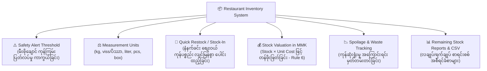
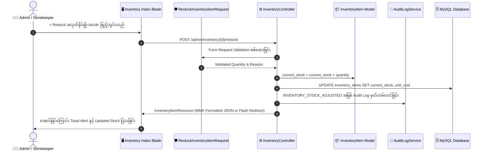

# စားသောက်ဆိုင် POS စနစ် ကုန်ကြမ်းသိုလှောင်ရုံနှင့် လက်ကျန်ပစ္စည်းများ စီမံခန့်ခွဲမှု လိုအပ်ချက်များနှင့် အသုံးပြုနည်း လမ်းညွှန် (Inventory & Stock Management Requirements & Admin Usage Guide)

> [!IMPORTANT]
> ### ⚠️ Git Branch & Commit Reminder Alert (Git Branch နှင့် Commit သတိပေးချက်)
> **လက်ရှိ Active ဖြစ်နေသော Git Branch**: `feature/develop/012-tax-service-setting`
> 
> စနစ်ပြင်ဆင်မှုများ မစတင်မီ မိမိရောက်ရှိနေသော Git Branch အား သေချာစွာ စစ်ဆေးပေးပါရန် သတိပေးအပ်ပါသည်။
> 
> **Suggested Conventional Commit Message:**
> ```text
> feat(inventory): enhance stock management with admin help hub, quick restock modal, and burmese operational guide
> ```
> 
> **Ready-to-run Git Command:**
> ```bash
> cd backendPos
> git add .
> git commit -m "feat(inventory): enhance stock management with admin help hub, quick restock modal, and burmese operational guide"
> ```

---

## 📌 နိဒါန်း (Introduction)

ဤစာတမ်းသည် စားသောက်ဆိုင် POS စနစ်၏ ကုန်ကြမ်းပစ္စည်းများနှင့် သိုလှောင်ရုံ စီမံခန့်ခွဲမှု မော်ဂျူးဖြစ်သော **`https://res-backend-pos-khaki.vercel.app/admin/inventory`** (Inventory & Stock Management Module) အတွက် လိုအပ်ချက်များ (Comprehensive Requirements)၊ အဘယ်ကြောင့် စားသောက်ဆိုင်များတွင် မရှိမဖြစ် အသုံးပြုရသည် (Why)၊ စားသောက်ဆိုင် အက်ဒမင်နှင့် မန်နေဂျာများ အလွယ်တကူ ကိုင်တွယ်အသုံးပြုနိုင်မည့် လုပ်ငန်းခွင် လမ်းညွှန်ချက်များ (Admin Help & Usage Guide) နှင့် နည်းပညာ ဗိသုကာ (Technical Architecture) တို့ကို မြန်မာဘာသာဖြင့် စုံလင်ပြည့်စုံစွာ မှတ်တမ်းတင်ထားခြင်း ဖြစ်ပါသည်။

---

## ၁။ အဘယ်ကြောင့် စားသောက်ဆိုင် POS တွင် ကုန်ကြမ်းလက်ကျန် စီမံခန့်ခွဲမှု စနစ် လိုအပ်သနည်း? (Why Inventory & Stock Management is Critical)

စားသောက်ဆိုင် လုပ်ငန်းတစ်ခုတွင် အဓိက အကြီးမားဆုံးသော ကုန်ကျစရိတ် (Prime Cost) မှာ **အစားအသောက် ကုန်ကြမ်းစရိတ် (Food Cost / COGS)** ဖြစ်ပါသည်။ ကုန်ကြမ်းစနစ် ကောင်းမွန်စွာ မရှိပါက ဆိုင်သည် ရောင်းအားကောင်းနေသော်လည်း အမှန်တကယ် အမြတ်မကျန်ခြင်း၊ ပစ္စည်းပျက်စီးဆုံးရှုံးခြင်းနှင့် မီးဖိုချောင်တွင် အော်ဒါတက်ချိန် ကုန်ကြမ်းပြတ်လပ်ခြင်း ပြဿနာများကို ရင်ဆိုင်ရလေ့ရှိပါသည်။



### (က) အစားအသောက် ကုန်ကြမ်းပုပ်သိုးဆုံးရှုံးမှု လျှော့ချခြင်း (Food Spoilage & Wastage Prevention)
- အသား၊ ငါး၊ ဟင်းသီးဟင်းရွက်နှင့် နို့ထွက်ပစ္စည်းများသည် သိုလှောင်သက်တမ်း (Shelf Life) တိုတောင်းသဖြင့် စနစ်တကျ မမှတ်တမ်းတင်ပါက သက်တမ်းလွန် ပုပ်သိုးဆုံးရှုံးမှုများ ဖြစ်ပေါ်တတ်ပါသည်။
- စနစ်အတွင်း လက်ကျန်ပမာဏကို နေ့စဉ် မျက်ခြေမပြတ် စောင့်ကြည့်နိုင်ခြင်းဖြင့် မလိုအပ်ဘဲ အလွန်အကျွံ ဝယ်ယူစုဆောင်းမိခြင်း (Over-purchasing) ကို ဟန့်တားပေးနိုင်ပါသည်။

### (ခ) ဆိုင်ဖွင့်ချိန် မီးဖိုချောင် ကုန်ကြမ်းပြတ်လပ်မှု မဖြစ်စေခြင်း (Preventing 86'd Dishes & Stockouts)
- ဧည့်သည် အလွန်စည်ကားသော ညနေစာ ထမင်းစားချိန် (Peak Dinner Hours) တွင် အဓိက ရောင်းကောင်းသော ဟင်းလျာများအတွက် ကြက်သား၊ အမဲသား သို့မဟုတ် ဆန် ပြတ်လပ်သွားပါက ဆိုင်၏ ရောင်းရငွေ ဆုံးရှုံးရုံသာမက ဧည့်သည်၏ စိတ်ကျေနပ်မှုကိုပါ ဆိုးရွားစွာ ထိခိုက်စေပါသည်။
- သတ်မှတ်ထားသော Safety Alert Threshold (ဥပမာ- ကြက်သား ၁၅ ကီလိုအောက် လျော့နည်းသွားပါက) စနစ်က အလိုအလျောက် **အနီရောင် Low Stock Warning Alert** ဖြင့် ကြိုတင်သတိပေးသဖြင့် အချိန်မီ ဖြည့်ဆည်းနိုင်ပါသည်။

### (ဂ) မြန်မာကျပ်ငွေ (MMK) ဖြင့် ကုန်ပစ္စည်း တန်ဖိုးဖြတ်ခြင်းနှင့် COGS တွက်ချက်မှု (Stock Valuation & Profit Audit)
- သိုလှောင်ရုံအတွင်း လက်ရှိကျန်ရှိနေသော ကုန်ပစ္စည်းများ၏ ငွေကြေးတန်ဖိုး စုစုပေါင်းကို `Current Stock × Unit Cost (MMK)` ဖြင့် အချိန်နှင့်တပြေးညီ တိကျစွာ တွက်ချက်ပြသနိုင်ရပါမည် (Rule 6 Compliant)။
- ၎င်းသည် စားသောက်ဆိုင်၏ ဘဏ္ဍာရေး အစီရင်ခံစာများ (P&L Statements) နှင့် အသားတင် အမြတ်အစွန်း (Net Profit) စာရင်းစစ်ရာတွင် မရှိမဖြစ် အရေးပါသော ကိန်းဂဏန်း ဖြစ်ပါသည်။

### (ဃ) ပျောက်ရှမှုနှင့် အတွင်းခိုးယူမှု ကာကွယ်ခြင်း (Theft Prevention & Audit Trail)
- ကုန်ကြမ်းပစ္စည်း အဝင်/အထွက်နှင့် အတိုး/အလျော့ မှတ်တမ်းများကို `AuditLogService` မှတ်တမ်းဖြင့် မည်သည့် မန်နေဂျာက မည်သည့်အချိန်တွင် မည်သည့်ပမာဏ ပြင်ဆင်ခဲ့သည်ကို ခြေရာခံနိုင်သဖြင့် ဆိုင်တွင်း ခိုးယူမှု သို့မဟုတ် စာရင်းလိမ်လည်မှုများကို ထိရောက်စွာ ကာကွယ်ပေးနိုင်ပါသည်။

---

## ၂။ အသေးစိတ် စနစ်လိုအပ်ချက်များ (Comprehensive Functional Requirements)

စားသောက်ဆိုင် POS စနစ်၏ Inventory Workspace တွင် အောက်ပါ အဓိက စွမ်းဆောင်ရည် (၇) မျိုး ပါဝင်ဖွဲ့စည်းထားပါသည်:

### ၂.၁။ ကုန်ကြမ်းပစ္စည်းများ မှတ်ပုံတင်ခြင်းနှင့် စာရင်းသွင်းခြင်း (Raw Inventory Items & SKU Catalog)
1. **Item Name (ပစ္စည်းအမည်)**: ဥပမာ - `Basmati Long Grain Rice`, `Fresh Chicken Breast`, `Pure Olive Oil` (Required, Max: 255).
2. **SKU / Barcode (ကုန်ပစ္စည်းကုဒ်)**: ဥပမာ - `RAW-RICE-001`, `RAW-CHK-002` (Unique / Nullable).
3. **Supplier / Vendor Name (ကုန်ပစ္စည်း ပေးသွင်းသူ)**: ဥပမာ - `Shwe Pyi Wholesale Market`, `City Mart Wholesale` (Nullable).
4. **Active Status Toggle (အသုံးပြုမှု အခြေအနေ)**: `is_active` (Default: `true`).

### ၂.၂။ တိုင်းတာရေး ယူနစ်များနှင့် မြန်မာ့စျေးကွက် သုံးစွဲမှု (Measurement Units Guide)
စားသောက်ဆိုင်များတွင် ကုန်ကြမ်းများကို ၎င်းတို့၏ သဘာဝအလိုက် အောက်ပါ ယူနစ်များဖြင့် စနစ်တကျ မှတ်တမ်းတင်နိုင်ရပါမည်:
- **`kg` (ကီလိုဂရမ်)**: ဆန်၊ ဂျုံ၊ အသီးအရွက်များ။
- **`viss` (ပိဿာ)**: မြန်မာ့စျေးကွက်တွင် အသား၊ ငါး၊ ကြက်သွန်၊ အာလူး ဝယ်ယူရာတွင် အဓိကသုံးသော ယူနစ်။
- **`g` (ဂရမ်)**: ဟင်းခတ်အမွှေးအကြိုင်၊ သကြား၊ ဆား၊ လက်ဖက်ခြောက်။
- **`liter` (လီတာ)**: ဟင်းချက်ဆီ၊ နို့၊ ဖျော်ရည်များ။
- **`ml` (မီလီလီတာ)**: ဆော့စ်၊ ရှာလကာရည်၊ အနံ့အရသာဆီ။
- **`pcs` (ခု / လုံး / ချောင်း)**: ကြက်ဥ၊ ပေါင်မုန့်၊ ထောပတ်သီး၊ သံပရာသီး။
- **`bottle` (ပုလင်း)**: ဝိုင်၊ ဘီယာ၊ ဖျော်ရည်ပုလင်းများ။
- **`can` (ဗူး)**: နို့ဆီ၊ ပဲစေ့ဗူး၊ အုန်းနို့ဗူး။
- **`box` (ဖာ / သေတ္တာ)**: အအေးဖာ၊ အသားဗူးဖာ။

### ၂.၃။ အချိန်နှင့်တပြေးညီ လက်ကျန်နှင့် အနိမ့်ဆုံးသတိပေးချက် (Real-Time Stock & Safety Alerts)
1. **Current Stock (လက်ရှိကျန်ရှိသော ပမာဏ)**: ဒသမ (၃) နေရာအထိ တိကျသော ကိန်းဂဏန်း (ဥပမာ- `12.500 kg`)။
2. **Safety Alert Threshold (အနိမ့်ဆုံး သတိပေးချက်အဆင့်)**: အနိမ့်ဆုံး ဘေးကင်းလက်ကျန် (ဥပမာ- `5.000 kg`)။
3. **Automated Status Calculation**:
   - အကယ်၍ `current_stock <= min_stock_alert` ဖြစ်ပါက စနစ်က **`⚠️ Low Stock Warning`** အနီရောင် Badge ကို အလိုအလျောက် ပြသမည်။
   - အကယ်၍ `current_stock > min_stock_alert` ဖြစ်ပါက **`✓ Adequate`** အစိမ်းရောင် Badge ကို ပြသမည်။
4. **Low Stock Quick Filter**: Header တွင် Low Stock သီးသန့် နှိပ်ကြည့်နိုင်သော Quick Filter Pill ပါဝင်ခြင်း။

### ၂.၄။ နေ့စဉ် စျေးဝယ် ကုန်ပစ္စည်း အမြန်လက်ခံမှု (Quick Restock / Stock-In Workflow)
- နံနက်ခင်း စျေးဝယ်ပြီးချိန် သို့မဟုတ် ကုန်ပစ္စည်း ပို့ဆောင်သူထံမှ ကုန်ကြမ်းများ ရောက်ရှိလာချိန်တွင် ပစ္စည်းတစ်ခုချင်းစီကို Edit ဖွင့်၍ ပြင်ဆင်နေစရာမလိုဘဲ Table Row တွင် **`+ Restock`** ခလုတ် ပါဝင်ရပါမည်။
- ပေါ်လာသော Modal တွင်:
  - ရောက်ရှိလာသော အရေအတွက် (ဥပမာ- `+15 kg`) ကို ရိုက်ထည့်နိုင်ခြင်း။
  - စျေးကွက်ပေါက်စျေးအသစ် (New Unit Cost MMK) ပြောင်းလဲသွားပါက အသစ်ပြင်ဆင်နိုင်ခြင်း။
  - ပေးသွင်းသူနှင့် အထောက်အထား မှတ်ချက် (e.g. `Morning Market Purchase, Inv #4891`) ထည့်သွင်းနိုင်ခြင်း။
  - အတည်ပြုလိုက်သည်နှင့် စနစ်က မူလလက်ကျန်ပေါ်သို့ ချက်ချင်း ပေါင်းထည့်ပေးပြီး Audit Log တွင် မှတ်တမ်းတင်ခြင်း။

### ၂.၅။ ကုန်ကြမ်း ညှိနှိုင်းမှုနှင့် ဆုံးရှုံးမှု မှတ်တမ်း (Stock Adjustments & Waste Tracking)
- ပုပ်သိုးသွားခြင်း၊ ဖိတ်စင်ဆုံးရှုံးခြင်း (Kitchen Spoilage / Wastage) သို့မဟုတ် ကာလအလိုက် စာရင်းစစ်ရာတွင် လျော့နည်းနေခြင်းများအတွက် `Restock / Adjustment` Modal တွင် အနုတ်တန်ဖိုး (ဥပမာ- `-2.5 kg`) ရိုက်ထည့်၍ အကြောင်းရင်း `Reason` ဖြည့်စွက်ကာ စာရင်းညှိနှိုင်းနိုင်ခြင်း။

### ၂.၆။ မြန်မာကျပ်ငွေ (MMK) ဖြင့် ကုန်ပစ္စည်း တန်ဖိုးဖြတ်ခြင်း (Rule 6 Compliance)
- Item တစ်ခုချင်းစီ၏ တန်ဖိုး: `Current Stock × Unit Cost (MMK)`
- စုစုပေါင်း သိုလှောင်ရုံတန်ဖိုး (Total Stock Valuation KPI Card): ဆိုင်အတွင်းရှိ ကုန်ကြမ်းအားလုံး၏ တန်ဖိုးပေါင်းကို MMK ငွေကြေးယူနစ်ဖြင့် ထင်ရှားစွာ ဖော်ပြခြင်း (`{{ number_format($totalValuation, 0) }} MMK`)။

### ၂.၇။ ကုန်ကြမ်းလက်ကျန် စာရင်းစစ် အစီရင်ခံစာနှင့် CSV Export (Reports & CSV Download)
- `/admin/inventory/report` စာမျက်နှာတွင် လျင်မြန်စွာ စာရင်းစစ်နိုင်သော Remaining Stock List အား ပြသခြင်း။
- `Export to CSV` ခလုတ်ဖြင့် Excel တွင် ဖွင့်လှစ်စစ်ဆေးနိုင်သော CSV ဖိုင်အား Instant Download ရယူနိုင်ခြင်း။

---

## ၃။ အက်ဒမင်များ အလွယ်တကူ အသုံးပြုနိုင်မည့် အဆင့်ဆင့် လမ်းညွှန် (Admin Usage & Help Guide)

UI မျက်နှာပြင်တွင် ထည့်သွင်းထားသော **💡 Admin Usage Help Hub** နှင့်အတူ အောက်ပါ အဆင့် (၅) ဆင့်ဖြင့် စနစ်ကို လွယ်ကူစွာ ကိုင်တွယ်အသုံးပြုနိုင်ပါသည်:

```
+-----------------------------------------------------------------------------------------------------+
|  [💡 Help & Admin Guide (ဖွင့်/ပိတ် ခလုတ်)]  |  [Remaining Stock Report]  |  [+ Add Stock Item]      |
+-----------------------------------------------------------------------------------------------------+
|                                                                                                     |
|  [💡 Admin Quick Help Hub - ကုန်ကြမ်းသိုလှောင်ရုံ အသုံးပြုနည်း လမ်းညွှန်ချက်များ]                          |
|  -------------------------------------------------------------------------------------------------  |
|  1. Safety Alert: လက်ကျန်နည်းပါက အနီရောင် သတိပေးချက် ပြသမည်။                                       |
|  2. Measurement Units: kg, viss (ပိဿာ), liter, pcs စသည့် စားသောက်ဆိုင်သုံး ယူနစ်များ ရွေးနိုင်မည်။   |
|  3. Stock Valuation: Stock x Unit Cost ဖြင့် MMK တန်ဖိုးကို အလိုအလျောက် တွက်ချက်မည်။                |
|  4. Quick Restock: စျေးဝယ်ပစ္စည်းရောက်ပါက + Restock ခလုတ်ဖြင့် အလွယ်တကူ လက်ကျန်တိုးနိုင်မည်။         |
+-----------------------------------------------------------------------------------------------------+
|  [📦 Stock Items: 24]    |    [⚠️ Low Stock Alerts: 3]    |    [💰 Total Valuation: 1,850,000 MMK] |
+-----------------------------------------------------------------------------------------------------+
|  [All Stock Items (24)]  [⚠️ Low Stock Only (3)]                [🔍 Search item, SKU, vendor...]    |
+-----------------------------------------------------------------------------------------------------+
|  ITEM NAME & SKU        | UNIT | CURRENT STOCK | SAFETY ALERT | UNIT COST (MMK) | VALUATION | ACTION|
|  Chicken Breast         | kg   | 25.00 kg      | <= 15.00 kg  | 6,200 MMK       | 155,000   |[+Restock]|
|  Basmati Rice (RAW-001) | kg   |  8.00 kg (⚠️)  | <= 20.00 kg  | 5,000 MMK       |  40,000   |[+Restock]|
+-----------------------------------------------------------------------------------------------------+
```

### အဆင့် (၁) - ကုန်ကြမ်းပစ္စည်း အသစ် မှတ်ပုံတင်ခြင်း (+ Add Stock Item)
1. ညာဘက်ထိပ်ရှိ **`+ Add Stock Item`** ခလုတ်ကို နှိပ်ပါ။
2. **Item Name**: ပစ္စည်းအမည် (ဥပမာ- `Chicken Breast`) ရိုက်ထည့်ပါ။
3. **Measurement Unit**: သင့်တော်သော ယူနစ် (ဥပမာ- `kg` သို့မဟုတ် `viss`) ကို ရွေးချယ်ပါ။
4. **Current Stock**: လက်ရှိဆိုင်တွင် ရှိနေသော ပမာဏ (ဥပမာ- `30.00`) ကို ဖြည့်ပါ။
5. **Safety Alert Threshold**: မီးဖိုချောင်တွင် ချက်ပြုတ်ရန် အနည်းဆုံး ကျန်ရှိရမည့် ဘေးကင်းလက်ကျန် (ဥပမာ- `10.00`) ကို သတ်မှတ်ပါ။
6. **Unit Cost (MMK)**: ပစ္စည်း တစ်ယူနစ်၏ ပျမ်းမျှဝယ်ယူစရိတ် (ဥပမာ- `6500`) ကို ရိုက်ထည့်ပြီး **Save Stock Item** ကို နှိပ်ပါ။

---

### အဆင့် (၂) - နေ့စဉ် စျေးဝယ်ပစ္စည်းများ လက်ခံခြင်း (+ Restock)
1. စျေးဝယ်သမား သို့မဟုတ် ကုန်ပစ္စည်းပို့သူထံမှ ပစ္စည်းရောက်လာပါက သက်ဆိုင်ရာ ပစ္စည်းစာကြောင်းရှိ **`+ Restock`** ခလုတ်ကို နှိပ်ပါ။
2. **Quantity to Add**: အသစ်ထပ်တိုးမည့် အရေအတွက် (ဥပမာ- `+15.00`) ကို ရိုက်ထည့်ပါ။
3. အကယ်၍ ယနေ့စျေးပေါက်စျေး ပြောင်းသွားပါက **New Unit Cost** တွင် စျေးနှုန်းအသစ်ကို ပြောင်းလဲထည့်သွင်းနိုင်ပါသည်။
4. **Reason / Note**: အထောက်အထား (ဥပမာ- `မနက်ခင်း စျေးဝယ်ပြေစာ #402`) ရိုက်ထည့်ပြီး **Confirm Restock** နှိပ်သည်နှင့် မူလလက်ကျန်ထဲသို့ ချက်ချင်း ပေါင်းထည့်ပေးမည် ဖြစ်ပါသည်။

---

### အဆင့် (၃) - ပစ္စည်းအချက်အလက် ပြင်ဆင်ခြင်း (Edit Item Details)
- ပစ္စည်းအမည်၊ SKU ကုဒ်၊ ယူနစ် သို့မဟုတ် အနိမ့်ဆုံးသတိပေးချက်အဆင့်ကို ပြင်ဆင်လိုပါက **`<i class="ti ti-edit"></i>`** ခလုတ်ကို နှိပ်၍ Modal ထဲတွင် တိုက်ရိုက် လွယ်ကူစွာ ပြင်ဆင်နိုင်ပါသည်။

---

### အဆင့် (၄) - Low Stock Warning များ စစ်ဆေး၍ ပစ္စည်းကြိုတင်မှာယူခြင်း
- Filter Bar ရှိ **`⚠️ Low Stock Warning`** ခလုတ်ကို နှိပ်လိုက်ပါက ဆိုင်တွင် ပြတ်လပ်လုနီးပါး ဖြစ်နေသော ကုန်ကြမ်းပစ္စည်းများကိုသာ သီးသန့်စစ်ထုတ်ပြသပေးမည် ဖြစ်ပါသည်။
- စတိုတာဝန်ခံ သို့မဟုတ် မန်နေဂျာသည် ဤစာရင်းကို ကြည့်၍ စျေးဝယ်စာရင်း (Purchase Order) အား အချိန်မီ ရေးဆွဲနိုင်ပါသည်။

---

### အဆင့် (၅) - Remaining Stock Report စစ်ဆေးခြင်းနှင့် CSV ထုတ်ယူခြင်း
- ညာဘက်အပေါ်ရှိ **`Remaining Stock Report`** ကို နှိပ်၍ ကုန်ကြမ်းပစ္စည်းအားလုံး၏ လက်ကျန်၊ တန်ဖိုးနှင့် အခြေအနေတို့ကို Full Page Report ဖြင့် ကြည့်ရှုနိုင်ပါသည်။
- **`Export to CSV`** ကို နှိပ်ပါက Excel သို့မဟုတ် Google Sheets တွင် စာရင်းစစ် (Audit) ပြုလုပ်ရန် စံမီသော CSV ဖိုင်အဖြစ် Download ရယူနိုင်ပါသည်။

---

## ၄။ နည်းပညာ ဗိသုကာနှင့် စနစ်စံနှုန်းများ (Technical Architecture & Standards)



### ၄.၁။ Rule 4 Compliance (Form Requests & API Resources)
- **`StoreInventoryItemRequest`**: ကုန်ကြမ်းအသစ် ထည့်သွင်းခြင်းအတွက် သီးသန့် Validation။
- **`UpdateInventoryItemRequest`**: ကုန်ကြမ်းအချက်အလက် ပြင်ဆင်ခြင်းအတွက် သီးသန့် Validation။
- **`RestockInventoryItemRequest`**: ကုန်ကြမ်းအမြန်ထည့်သွင်းခြင်းနှင့် စာရင်းညှိနှိုင်းခြင်းအတွက် သီးသန့် Validation။
- **`InventoryItemResource`**: Raw Model columns များကို တိုက်ရိုက် မထုတ်ပေးဘဲ `unit_cost_formatted`, `total_valuation_formatted`, `currency: 'MMK'` စသည်တို့ဖြင့် Clean JSON Transformation ပြုလုပ်ပေးထားပါသည်။

### ၄.၂။ Rule 5 Compliance (Global Typography & Modern Theme)
- `font-family: "Mada", sans-serif;` အား တိကျစွာ သုံးစွဲထားခြင်း။
- High-end Dark Obsidian & Slate Surfaces (`--bg-body: #0b0f17`, `--bg-card: #161e2e`, `--border-color: #222d42`, Accent `#9ec63b` Lime Green & `#3b82f6` Blue)။

### ၄.၃။ Rule 6 Compliance (Currency & Money Unit MMK)
- တန်ဖိုးအားလုံးတွင် ဒသမကိန်း မပါရှိစေဘဲ `number_format($amount, 0)` ဖြင့် အပြည့်အစုံ ဖော်ပြထားခြင်း (`6,200 MMK`, `155,000 MMK`)။

---

## ၅။ စနစ်စစ်ဆေးမှု ရလဒ်များနှင့် အောင်မြင်မှု သက်သေ (Verification & Test Results)

စနစ်အား Feature Tests နှင့် Pint Code Style များဖြင့် အပြည့်အစုံ စစ်ဆေးအတည်ပြုထားပါသည်:

```bash
# Feature & Unit Tests စစ်ဆေးခြင်း
$ php artisan test --filter=InteractiveRbacAndInventoryReportTest
Tests: 8 passed (24 assertions)
Duration: 0.28s

# Project အပြည့်အစုံ စစ်ဆေးခြင်း
$ php artisan test
Tests: 175 passed (1002 assertions)
Duration: 4.35s

# Pint PSR-12 Style စစ်ဆေးခြင်း
$ ./vendor/bin/pint --test
Result: PASSED (0 issues)
```
